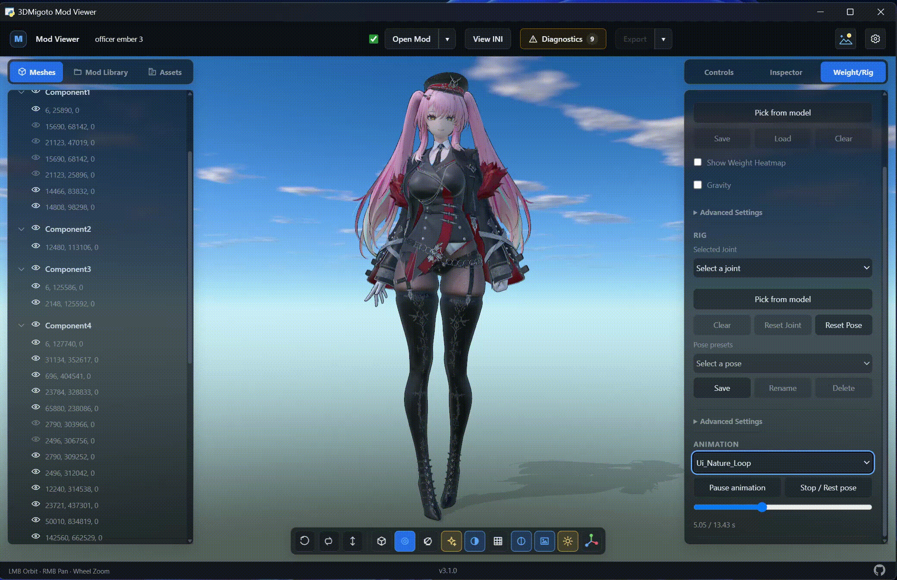

# 3DMigoto Mod Viewer

A desktop app for inspecting 3DMigoto character mods in 3D without launching the
game. Pick a mod folder and the viewer reads its INIs, buffers and textures,
rebuilds the model in a WebGPU viewport, and lets you preview toggles and
animations, inspect textures and weights, pose the model, and stage INI or mesh
edits that are written only when you click `Export`.

Supports Zenless Zone Zero (ZZMI), Genshin Impact (GIMI) and Wuthering Waves
(WWMI) mods, with conservative support for Honkai: Star Rail (SRMI).



## Quick start

- **Portable build:** run the executable on 64-bit Windows. It needs the
  Microsoft Edge WebView2 Runtime (built into Windows 11, delivered to Windows 10
  through Windows Update) and a WebGPU-capable GPU.
- **From source:** see [Running from source](#running-from-source).

Then click `Open Mod`, choose a mod folder, and drag in the viewport to look
around. The UI is available in English, Simplified Chinese, Japanese, Korean,
Spanish and Russian (`Settings` > `Language`); the steps below use the English
labels.

## What the app can do

### 1. Load a mod

- **Folder:** `Open Mod` and select the folder that holds the mod's INI, buffers
  and textures. Builds that allow it show an `Open disabled mod` checkbox for
  `DISABLED`-prefixed INIs.
- **Archive:** the arrow beside `Open Mod` > `Open Archive…` previews a ZIP, 7z or
  RAR without extracting it (7z/RAR need 7-Zip installed). Archive previews are
  read-only.
- **Import (GIMI):** the same menu's `Import Mod…` consolidates static variant
  buffers into a shared, deduplicated layout for this session. The source files
  are not changed, and Export is unavailable for imported mods.
- **Mod Library:** open `Mod Library` on the left, click `+`, name a folder and
  `Add` it. Click any mod or archive in the tree to load it; folder menus offer
  `Open Folder`, `Edit` and `Remove`.

To hide one INI of a multi-INI mod, right-click its header in `Meshes` and choose
`Remove`. The viewer reloads without it and remembers the exclusion in
`.mod_viewer.json` (the INI itself is untouched).

### 2. Navigate and inspect

**Viewport.** Left-drag orbits, right-drag pans, scroll zooms. The toolbar groups
its tools into:

- **Display:** wireframe, outlines, smooth shading, `Toon shadows`, grid, `Glossy
  materials` and `Ambient occlusion` (0–100%), the texture filter (`All maps`,
  `Diffuse and NormalMap`, `Diffuse only`, `No textures`) and `Emission bloom`
  when a GlowMap is found.
- **Lighting:** `Key light` intensity, plus environments `Default`, `Studio`,
  `Indoor`, `Outdoor` and `Sunset`. Drag the light marker to move it (hold Shift
  to move it toward or away from the camera).
- **View:** `Reset`, `Turn`, `Tilt`, the navigation gizmo (drag to orbit, click an
  axis to snap) and focus mode.

**Panels.** The left icon rail switches between `Meshes`, `Mod Library` and
`Assets`; the right dock holds `Inspector`, `Controls` and `Weight/Rig`. Drag a
dock edge to resize it, use `[` / `]` to collapse the left/right dock, and `\` for
focus mode, which hides both.

**Meshes.** Eye buttons show or hide an INI, component or mesh; headers show
visible/total counts. Type in the filter box to search mesh, component and INI
names, and switch between `All`, `Visible` and `Hidden`. Right-click a mesh to
`Rename` it, `Isolate Selected` (undo with `Exit Isolation` in the header), or
reach the edit actions below.

**Selection shortcuts**

| Action | Input |
| --- | --- |
| Select / frame and open Inspector | Click / double-click a row or the model |
| Toggle in selection / add a rectangle | Ctrl-click / Ctrl-drag in the viewport |
| Select a range of rows / add a range | Shift-click / Ctrl+Shift-click |
| Select all | Ctrl+A (panel: every row passing the filter; viewport: visible meshes) |
| Frame / hide the selection | `F` / `H` |

Clicking the eye of a selected mesh shows or hides the whole selection.

**Inspector.** Choose a `Material` kind (or `Auto`) and a `Texture` (a file,
`Automatic` or `None`). `Manage textures` assigns any DDS, PNG or JPG in the mod to
a map role for the preview, without changing the INI. Expand `UV` to see the
triangle layout over the diffuse texture, including tiling outside 0–1;
`Expand UV view` shows it over the viewport.

### 3. Preview controls, animations and PRESENT combinations

Open `Controls`. Each `Key Toggle` row has a cycle button (and a previous-value
button for three or more positions); `Menu Toggle` buttons and shape sliders work
the same way. Control changes only touch meshes wired to the changed variables,
so your manual visibility choices elsewhere stay put.

**Animation.** Supported animations play automatically while their conditions
are active: baked mesh animation, GIMI compute-driven pose/shape animation, and
narrow WWMI shape patterns. Custom shaders may stay static, so playback can
differ from the game. The playback dock above the toolbar provides:

- Play/Pause (Space), `Stop` (back to the first frame) and, for baked timelines,
  an `Animation frame` slider.
- With a game rig loaded (see step 7), a searchable picker for `Clips`,
  `Sequences` and WWMI `Shared` body-type clips, Previous/Next, and a time slider
  that spans every step of a sequence. Sequences crossfade between steps and
  carry root motion.
- `Show props` for weapons and skill objects that appear during clips.

The film-strip button hides the dock. Playback never changes control values.

**PRESENT combinations** let one shortcut switch several controls at once:

1. Set the controls, then `...` beside `Present` > `Add PRESENT`. Enter a `Key`
   (and optional `Back key`) and `Save` — this records `Present 1`.
2. Change the controls and click `New` for each further combination (up to ten).
   Cycle to one and use `Update` to revise or rename it, or `Delete` to remove it.
3. `...` > `Edit key binding` or `Remove PRESENT key` manage the shortcut.
4. `Export` writes the PRESENT cycle into the participating INIs.

If a multi-INI mod shows `Unavailable`, use `Complete PRESENT` when offered, or
fix conflicting entries in `View INI`.

### 4. Create a Key Toggle

**From selected meshes (show/hide):** select meshes from one INI, right-click >
`Create Toggle`, check the suggested name and key, and `Save`. The toggle is
already wired to those meshes.

**Custom cycle:**

1. In `Controls` > `Key Toggle`, click `+`. Pick the `Ini file`, a `Name`, `Key`
   (e.g. `1` or `ctrl 1`), optional `Back key`, a new `Variable name` (no `$`) and
   at least two `Values` (e.g. `0,1,2`). `Save`.
2. Open the toggle's actions menu and choose record. At each position, set mesh visibility
   in `Meshes`, then click the cycle button to move on.
3. `Save` the recording, cycle through to check it, and `Export`.

The same menu edits or deletes the toggle. A toggle that controls no meshes shows
a warning badge and blocks Export until it is recorded or deleted.

### 5. Separate and merge mesh parts

Requires a writable mod folder (not archives or Assets). Use the edit icons in the
Inspector header or the right-click menu:

- `Separate by Loose Parts` splits by connectivity; `Connection tolerance`
  (0–0.01) can join nearby vertices.
- `Separate by Selection` lets you pick faces (click, Ctrl-click, Ctrl+A,
  Ctrl-drag) and `Apply Selection`. Mode icons beside the left-panel tabs choose
  `Set`, `Extend`, `Subtract`, `Difference` or `Intersect`; `Select through
  (click)` also hits hidden faces. `Select Connected Faces` and `Invert Selection`
  are in Inspector. Escape cancels.
- `Merge Meshes` joins two or more parts of the same original mesh.

Undo/Redo (Ctrl+Z / Ctrl+Y) cover layout and face-selection steps. When the
layout is right, `Apply Mesh Changes` stages it (or `Cancel Mesh Changes`), and
`Export` writes the buffers and INIs.

### 6. Inspect weights and preview secondary motion

In `Weight/Rig` > `WEIGHT`:

1. `Select bones` to choose bone IDs (grouped by source buffer), or `Pick from
   model` to list the bones influencing a clicked point.
2. `Show Weight Heatmap` to see their influence.
3. Hold right-click and drag the model to test secondary motion, optionally with
   `Gravity`. `Advanced Settings` tunes frequency, damping, response and joint
   limits; `Reset physics` restarts the motion.
4. `Save` / `Load` / `Clear` store the bone selection in `.mod_viewer.json`.

Weight tools are preview-only and never rewrite weight buffers.

### 7. Pose the model and play game animations

`RIG` builds an inferred rig and a fitted humanoid control rig from the skin
weights. Pick a `Selected Joint` (or `Pick from model`) and drag the rotation
gizmo; `Reset Joint` / `Reset Pose` undo it. `Advanced Settings` adds rotation
snap, `Set selected as root` and `Enable Inverse Kinematics` (drag hand/foot
control points). `Main Rig` > `Edit Rig` corrects the fitted points, and `Pose
presets` saves named poses to `.mod_viewer.json`.

When an original Asset has an extracted game rig (step 9), Assets and compatible
mods use its named skeleton instead, and `ANIMATION` lists the game's clips and
sequences. Clips include facial morphs, spring-bone secondary motion and props;
in-game cloth simulation and game events are not replayed. Animation suspends
Weight physics, and manual posing stops playback. Turn on `Settings` > `Auto load
Weight/Rig` to load the rig and start the first animation automatically. See
[Asset rig sidecars](docs/asset-rig.md) for the formats.

Rig tools only pose the preview; they never write poses into the mod.

### 8. Recolor a mesh and save it to a texture

1. Select a mesh whose `Texture` resolves to a diffuse map from the mod.
2. In `Color`, adjust `Hue`, `Saturation`, `Brightness` (0–400%), `Contrast`,
   `R`/`G`/`B` and `Tint`. The preview updates live and is saved to
   `.mod_viewer.json`; `Reset Color` removes it.
3. `Save to Texture...` bakes the preview into a mod-owned BC7 DDS. Review the
   affected meshes and `Save`; a backup is created and the controls reset.

### 9. Work with original Assets

Original Assets are clean game extractions that fill gaps in mods and carry game
rigs and animations.

1. **Add a folder:** `Assets` > `+`, choose `ZZMI`, `GIMI` or `WWMI`, browse to the
   folder, `Add`. Use its `ON`/`OFF` switch for mod matching and `Rebuild asset
   index` after changing it outside the viewer.
2. **Fill missing parts:** with a mod loaded, `Load missing parts` in the `Meshes`
   header previews the original components the mod does not replace. `Settings` >
   `Auto restore missing mod parts from assets` does this on every load. Filled
   parts are preview-only.
3. **Extract a game rig and animations:** right-click an indexed Asset >
   `Extract Rig/Animation`, point to the game folder (or set it once in `Settings`
   > `Game directory`), and `OK`. Its row's settings button sets a default animation
   to play first. The viewer verifies the game mesh against the Asset before
   saving `Rig.json`, `Animation` and props into it; a failed run keeps the
   previous files. ZZZ and Genshin build a one-time game index first.
   Extraction is offline; a game update may need a new viewer release. Details:
   [game-folder extraction](docs/asset-rig.md#game-folder-extraction).
4. **Extract from a frame dump:** right-click an Asset Folder > `Add asset`, or an
   Asset > `Update asset` to replace it. Each Asset keeps an
   `extraction_report.json` listing skipped resources; a partial extraction shows a
   warning.
5. **Edit an opened Asset:** set textures in `Inspector` / `Manage textures`, or
   right-click a source header in `Meshes` > `Remove` to drop that source group.
   `Export` (or `Save Asset Edits`) saves texture assignments to the Asset's
   metadata or disables the removed folder with a `DISABLED_` prefix.

### 10. Check, edit and export

- **Diagnostics** (top toolbar) lists INI errors and warnings by INI, with filters
  for `Errors`, `Conditions`, `Resources` and `Files`, file counts, and an Asset
  match summary. It includes staged edits and works even if the model fails to
  load. Double-click an issue to open its line in the editor.
- **View INI** edits the text of any INI in the same staged session as toggles and
  recording; `Save` applies it to the preview.
- **Export** writes pending INI and mesh-buffer changes with timestamped `.BAK`
  backups. Failed writes stay pending for retry; switching mods warns before
  discarding staged work.
- **Blender / glTF (.glb)…** (arrow beside `Export`) saves the visible model as it
  currently looks — pose, shapes, animation frame, normals, UVs and Blender-ready
  textures — with skin weights as numbered vertex groups. Original texture roles
  and draw provenance are kept in `extras.modViewer`. Game rigs, animation tracks,
  shape keys and hidden toggle states are not exported. Not available for archives
  or Assets.

In a narrow window, `View INI`, `Diagnostics` and `Export` move into the toolbar's
`...` menu.

## What is saved, and when

| Change | Saved |
| --- | --- |
| INI text, Key Toggles, recordings, PRESENT | In memory until `Export` |
| Mesh separation and merging | Preview until `Apply Mesh Changes`, then until `Export` |
| Asset texture assignments and source-group removals | Until `Export` / `Save Asset Edits` |
| Mesh names, material/texture choices, color previews, removed INIs | `.mod_viewer.json`, automatically |
| Bone selections, Rig corrections, pose presets | `.mod_viewer.json`, by their `Save` buttons |
| `Save to Texture...` | Source DDS immediately, with a backup |
| Language, environment, dock widths, panel opacity, tool and Settings options | App settings, automatically |

Archives and imported mods cannot save edits or metadata. Filled missing parts,
manual visibility, camera and live physics are session-only.

## Compatibility and limitations

- Needs a WebGPU-capable system.
- Reconstruction covers common mod layouts; textures work best with
  SlotFix/Stable Texture conventions. Unusual layouts may load partially —
  Diagnostics still works on them.
- Animation, shapes, Rig tools and mesh editing depend on recognized layouts.
  Texture saving supports mod-owned BC7 DDS files only.
- Asset folders support ZZMI, GIMI and WWMI. Game extraction covers Wuthering
  Waves, Zenless Zone Zero and Genshin Impact.
- Password-protected archives are not supported.

## Running from source

```console
pip install -r src/requirements.txt
python src/viewer_app.py
```

Source runs show every feature. To build the portable app into `dist/`:

```console
python src/build.py
```

Native extraction helpers are rebuilt only when their sources or pinned
dependencies change (`--rebuild-helpers` forces it). Set flags in
`src/features.ini` before building to hide Export, Toggle editing, disabled-mod
loading or mesh editing in the portable build; the checked-in file hides only
disabled-mod loading.

### Optional MCP companion

`python src/mcp_server.py` starts an MCP server that lets an MCP client inspect
mods in your Mod Library and add, edit or delete Key Toggles. It uses the same
staged session as the app: nothing is written until `export_mod_changes` is
called.

## License

GPL-3.0-or-later. See [LICENSE](LICENSE).
