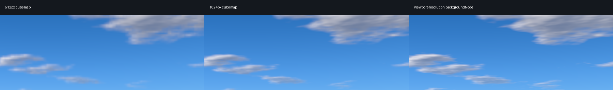
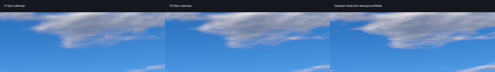
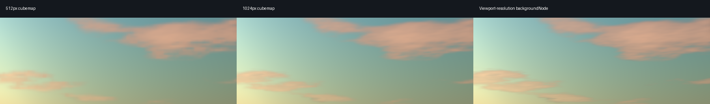
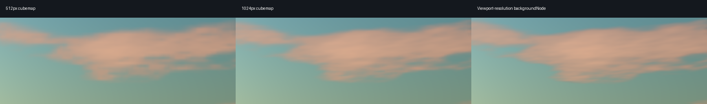

# Atmospheric environments

Outdoor and Sunset share the existing Three.js WebGPU renderer and SkyMesh
scattering model. A frozen atmosphere configuration supplies sun direction,
sun color/intensity, scattering, cloud coverage/density and sky exposure.
Directional sunlight follows that direction independently of the movable
inspection light. Hemisphere and ambient fill keep inspection materials readable.

Static clouds use MaterialX fractal noise from the vendored TSL library, with
sunward density sampling for shading and illuminated edges. Clouds fade into
atmospheric haze at the horizon; the lower hemisphere blends into a preset ground
color. Neither preset adds distance fog to models. SkyMesh's built-in cloud blend
is disabled so there is only one cloud layer. The approach was informed by
[web-ocean's atmosphere and clouds](https://github.com/Noniv/web-ocean/blob/main/js/wgsl/sky.js);
no source code or renderer was imported from that project.

## Visible sky and reflections

The visible sky uses `scene.backgroundNode`, evaluated at the viewport's render
resolution. It no longer enlarges a cached 512px cubemap. The exact same node is
captured by `PMREMGenerator.fromScene` at 256px for filtered reflections. No extra
viewport pass, renderer, atmosphere shader or user setting is needed.

The small adapter reuses the pinned Three.js r185 SkyMesh vertex initialization
and world-position varying on Three.js's background sphere. The background keeps
its own camera-independent far-plane projection. Vendored assets remain unchanged.
The cloud shader uses that same view direction. Its `fwidth` filter is evaluated
at each output's resolution, with a minimum width and the existing smooth density
transition. The derivative width is bounded below instead of always adding an
extra blur term; antialiasing remains enabled.

Sky highlights are compressed in linear space for both outputs. Models retain
the existing sRGB, NoToneMapping, AO and emission-only bloom behavior. The sky
never joins the model scene graph, so bounds, selection, outlines, rigging, AO
geometry and camera clipping need no sky-specific exclusions.

Environment resources are prepared on first use after renderer initialization.
Unselected queued work is skipped. Revisiting a preset reuses its node and PMREM;
camera movement evaluates the visible shader without recapturing reflections.
Static scenes retain on-demand rendering and submit no idle sky or shadow work.
Disposal restores the original background, environment and lights and releases
owned nodes, targets and generator resources. Page teardown releases the
controller, while a preserved browser page keeps it. Explicit preset reselection
permits one retry after failed preparation; passive preparation never retries,
pending selections share work, and errors are caught at the asynchronous boundary.

## Viewport comparison

The comparison uses identical camera, scene, device, browser arguments and pixel
ratio 1. Each of the three implementations has three fresh-browser runs at
1920 × 1080 and 2560 × 1440: the reviewed 512px cubemap, a 1024px cubemap, and the
viewport-resolution node. All retain 256px PMREM. Each run measures 30 camera
orbit frames after five warmup frames, with no concurrent browser benchmark.
The [recorded samples](benchmarks/environment-capture.json) include raw timings,
first activation, cached switching, idle counters and renderer allocation counts.
Timing includes browser scheduling and GPU queue completion; it is not isolated
GPU execution time or a portable frame-rate guarantee.

Values below are milliseconds. The distributions overlap, so these runs support
the direct path's practical camera cost without establishing a general speedup.
First Outdoor activation increases from approximately 0.8 s to 1.1 s in this
comparison; Sunset remains approximately 0.45 s. That one-time shader preparation
cost is separate from the steady camera-motion measurements.

| Viewport | Visible sky | Outdoor median / p95 | Sunset median / p95 |
| --- | --- | ---: | ---: |
| 1920 × 1080 | 512px cube | 23.0 / 27.6 | 14.9 / 25.9 |
| 1920 × 1080 | 1024px cube | 20.1 / 25.2 | 18.9 / 29.1 |
| 1920 × 1080 | Viewport node | 16.1 / 28.6 | 15.7 / 29.9 |
| 2560 × 1440 | 512px cube | 17.0 / 28.8 | 13.4 / 25.8 |
| 2560 × 1440 | 1024px cube | 15.5 / 28.8 | 20.8 / 29.8 |
| 2560 × 1440 | Viewport node | 15.8 / 26.4 | 15.3 / 26.7 |

Native-pixel cloud crops compare 512px, 1024px and viewport rendering from left to
right. No crop is resized or sharpened. The viewport shader retains small cloud
structure that cubemap enlargement softens, particularly at 2560 × 1440. Warm
Sunset illumination and the blue Outdoor atmosphere use the same parameters.






The direct approach is small enough and its measured camera cost supports using
it here. A 1024px visible cubemap improves the 512px result but still limits fine
viewport detail. No additional fallback path is retained. Outdoor and Sunset's
two cached PMREM color textures total 12 MiB; the visible sky has no cached color
texture, compared with 24 MiB for two 512px skies or 96 MiB for two 1024px skies.
These figures exclude depth, temporary resources and driver overhead. Memory
savings are a consequence of the direct path, not the visual acceptance criterion.

## Model and integration checks

The comparison scene includes normal/diffuse, plain diffuse, metal, dielectric
gloss, transparency/cutout hair, toon, unlit and emissive surfaces. The top row
is plain diffuse, toon, unlit and emissive; the bottom row is normal/diffuse,
metal, gloss and transparency/hair. Full viewport images retain this context:

| Preset | 1920 × 1080 | 2560 × 1440 |
| --- | --- | --- |
| Outdoor | [Full frame](images/environment-outdoor-1920.png) | [Full frame](images/environment-outdoor-2560.png) |
| Sunset | [Full frame](images/environment-sunset-1920.png) | [Full frame](images/environment-sunset-2560.png) |

The [combined Sunset frame](images/environment-sunset-2560-ao-bloom.png) retains
the emission halo around the emissive sample. In the recorded sky strip away
from that halo, direct, AO, bloom and combined output match exactly at both
resolutions under both presets.

The existing focused lifecycle checks cover empty scenes, model replacement,
all four viewport paths, preset restoration, panning with short clipping planes,
model scale, resize, the view gizmo and selection. Resource checks cover shared
sun direction and sky node, skipped work, 256px PMREM reuse, explicit retry,
caught asynchronous errors and disposal. These checks use generated fixtures.

## Reproducing the comparison

Install development dependencies, populate vendored assets, and use a compatible
Edge/WebGPU environment. From the repository root:

```sh
python tools/benchmark_environments.py --viewport 1920 1080 --output .quality-reports/sky-1920
python tools/benchmark_environments.py --viewport 2560 1440 --output .quality-reports/sky-2560
```

Use `--source path/to/environment.js` to serve a saved environment module in
the benchmark only. The cubemap baseline is available from
`git show 797b5f8:src/web/js/scene/environment.js`; change its
`SKY_CAPTURE_SIZE` constant from 512 to 1024 for the larger capture comparison.
Use the same device/settings and compare multiple runs. Each run captures direct,
AO, bloom and combined output, then measures camera orbit and cached switching.
Renderer allocation counters are Three.js estimates, not hardware VRAM telemetry.
First activation includes material shader preparation and should be compared
separately from camera motion. Check idle counters and before/after allocations
to verify on-demand rendering and cache reuse.

Browser checks and benchmarks remain explicit local tools. GitHub CI runs the
quality audit and unit/core/app/integration tests without browser or GPU tests.
