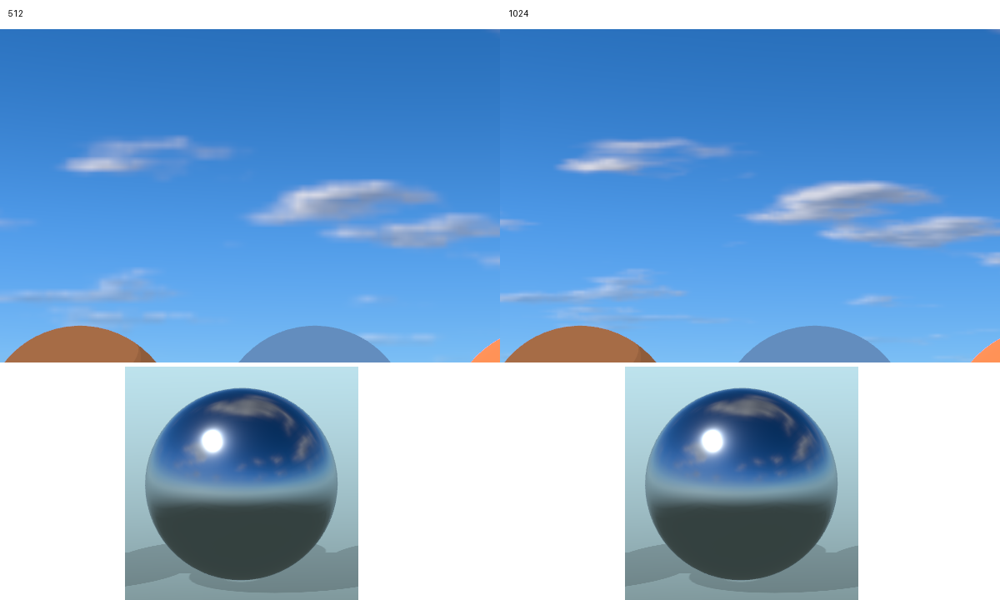
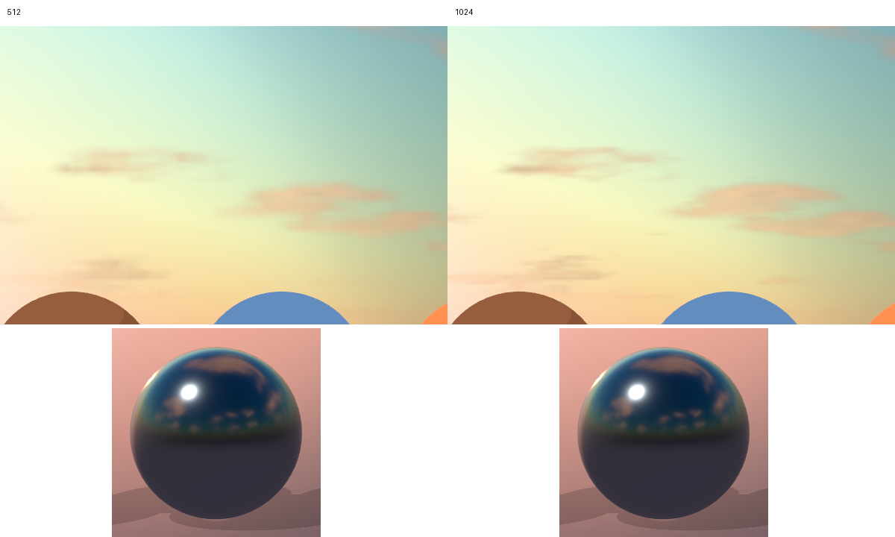

# Atmospheric environments

Outdoor and Sunset share the existing Three.js WebGPU renderer and SkyMesh
scattering model. A frozen atmosphere configuration supplies the sun direction,
sun color/intensity, scattering, cloud coverage/density and sky exposure.
Directional sunlight follows that direction independently of the movable
inspection light. Hemisphere and ambient fill keep inspection materials readable.

Static clouds use MaterialX fractal noise from the vendored TSL library, with
sunward density sampling for shading, illuminated edges, and filtered silhouettes.
Clouds fade into atmospheric haze at the horizon. The lower hemisphere blends
into a preset ground color. Neither preset adds distance fog to model meshes.
SkyMesh's built-in cloud blend is disabled so there is only one cloud layer.
The approach was informed by studying
[web-ocean's atmosphere and clouds](https://github.com/Noniv/web-ocean/blob/main/js/wgsl/sky.js);
no source code or renderer was imported from that project.

Each sky is captured once into a 512-pixel half-float cubemap. That same texture
supplies the viewport background and a 256-pixel PMREM capture. Highlight
compression happens in linear space during sky capture; model materials retain
the existing sRGB output, NoToneMapping, AO and emission-only bloom behavior.
The sky never joins the model scene graph, so model bounds, selection, outlines,
rigging, AO geometry and camera clipping do not need sky-specific exclusions.

Environment resources are generated on first use, after renderer initialization.
An unselected queued preset is skipped. Immutable configurations need no frame
updates or cache invalidation; replacing the controller rebuilds its resources.
Revisiting a preset reuses its targets. Disposal restores the original background,
environment and lights and releases all owned targets and generator resources.
Page teardown releases the controller, while a preserved browser page keeps it.
After a failed capture, explicitly selecting the preset again permits one new
attempt. Passive preparation does not retry, and selections during one pending
capture share that work. Preparation catches errors before its promise escapes.

## Capture resolution decision

512 pixels preserves the material response while reducing the two cached sky
textures from 96 MiB to 24 MiB. The two PMREM color textures add 12 MiB at either
resolution: cached sky plus reflection color storage is therefore 36 MiB instead
of 108 MiB, excluding depth, temporary resources and driver overhead. Capturing
six faces shades 1,572,864 pixels instead of 6,291,456.

The following comparison used identical synthetic materials, camera, renderer,
browser arguments and pixel ratio on the same device. Each case has three fresh
browser runs and five cached switches per preset per run. Outdoor is activated
before Sunset, so its time also includes preparation for newly environment-lit
materials. Values are medians in milliseconds; the
[recorded samples](benchmarks/environment-capture.json) also
contain allocation estimates, idle counters and material measurements.

| Viewport | Capture | First Outdoor | First Sunset | Cached Outdoor | Cached Sunset |
| --- | --- | ---: | ---: | ---: | ---: |
| 1280 × 900 | 512 | 805.8 | 420.6 | 77.8 | 74.2 |
| 1280 × 900 | 1024 | 785.3 | 427.5 | 76.1 | 77.5 |
| 2560 × 1440 | 512 | 811.2 | 431.3 | 75.9 | 78.0 |
| 2560 × 1440 | 1024 | 793.7 | 419.3 | 76.6 | 76.9 |

These measurements do not establish an activation-time improvement. They include
shader preparation, scheduling and queue completion, and do not isolate GPU
capture time. The reason for choosing 512 is the lower memory and capture pixel cost.
At 2560 × 1440, 1024 gives slightly sharper small cloud edges; that background
difference does not justify four times the sky storage for these static presets.
All cases retain zero idle viewport/shadow updates and stable cached allocations.

The images below contain native-resolution sky and metal crops from the large
viewport, with 512 on the left and 1024 on the right.




## Material comparison

The expanded scene includes separate normal/diffuse, plain diffuse, metal,
dielectric gloss, transparency/cutout hair, toon, unlit and emissive samples.
The top row is plain diffuse, toon, unlit and emissive; the bottom row is
normal/diffuse, metal, gloss and transparency/hair.

| Preset | 512 at 2560 × 1440 | 1024 at 2560 × 1440 |
| --- | --- | --- |
| Outdoor | [Full frame](images/environment-outdoor-512-large.png) | [Full frame](images/environment-outdoor-1024-large.png) |
| Sunset | [Full frame](images/environment-sunset-512-large.png) | [Full frame](images/environment-sunset-1024-large.png) |

Foreground circular regions around each sample differ by less than 0.17 per
8-bit RGB channel on average between resolutions. Toon and unlit regions match
exactly. Normal/diffuse and plain diffuse regions have no all-channel white
clipping under either preset; the small clipped specular regions on metal/gloss
remain effectively unchanged. Reflections retain the sky's blue upper hemisphere,
tinted ground and warm Sunset horizon. The independent inspection light accounts
for the bright white highlight on metal.

Transparency and cutout gaps remain readable. The
[Sunset AO/bloom frame](images/environment-sunset-512-ao-bloom.png) shows emission
bloom around the emissive sample while diffuse, toon and reflective surfaces
retain their response. AO leaves the sky unchanged. Emission adds its expected
local halo; the distant sky region differs by at most one 8-bit channel value.
Temporarily disabling the emissive sample makes the sky strip match direct
rendering exactly in all four paths under both presets. These synthetic samples
establish representative behavior rather than a guarantee for every authored mod.

## Reproducing visual and performance comparisons

Install the repository development dependencies, populate its vendored assets,
and use a compatible Edge/WebGPU environment. From the repository root:

```sh
python tools/benchmark_environments.py --sky-size 512 --viewport 1280 900 --output .quality-reports/environments-512
python tools/benchmark_environments.py --sky-size 1024 --viewport 1280 900 --output .quality-reports/environments-1024
```

Repeat with `--viewport 2560 1440` for the large comparison. The capture override
changes only the module served by this tool; it adds no runtime viewer setting.
Use the same device and settings, and compare multiple runs. Each run starts a
new browser and captures Outdoor and Sunset in direct, AO, bloom and combined modes.
The synthetic scene includes diffuse/normal, metal/gloss, transparency/cutout hair,
toon, unlit and emissive surfaces, with character shadows and AO.

Reports contain renderer startup, first activation, cached switching, explicit
sky/PMREM color storage, renderer allocation estimates and idle render/shadow
counts. Frame latency includes browser scheduling and completion of the GPU queue; it is not
an isolated GPU execution time. Allocation counters are Three.js estimates, not
hardware VRAM telemetry. First activation includes shader/capture preparation;
compare it separately from cached switching. Startup with Default should create
no environment maps, and idle scenes should submit no viewport or shadow work.
Compare allocation counts before/after cached switching to check resource reuse.

The original fixed-gradient Outdoor reference remains available in the
[reviewed revision](https://github.com/drelymk/mod_viewer/blob/383ab21805809849b7b5f9ea28f8499414bcf33e/docs/images/environment-outdoor-before.png).

The focused browser lifecycle test also exercises empty scenes, model replacement,
all four viewport paths, preset restoration, camera scale/clipping, resize,
the view gizmo and mesh selection. The module lifecycle test covers shared sun
direction, skipped work, resource reuse, explicit retry, caught asynchronous
errors, failure cleanup and disposal. The tool is retained for recurring capture
cost and material comparisons; it shares frame synchronization and omits the old
Git-module substitution and camera timing loop.

These browser checks and the comparison tool are explicit local tools. GitHub CI
continues to run the quality audit and unit/core/app/integration tests without
enabling browser or GPU tests.
