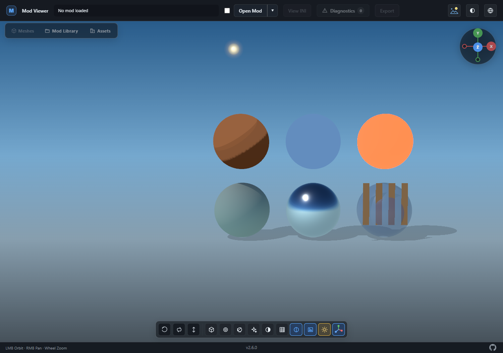
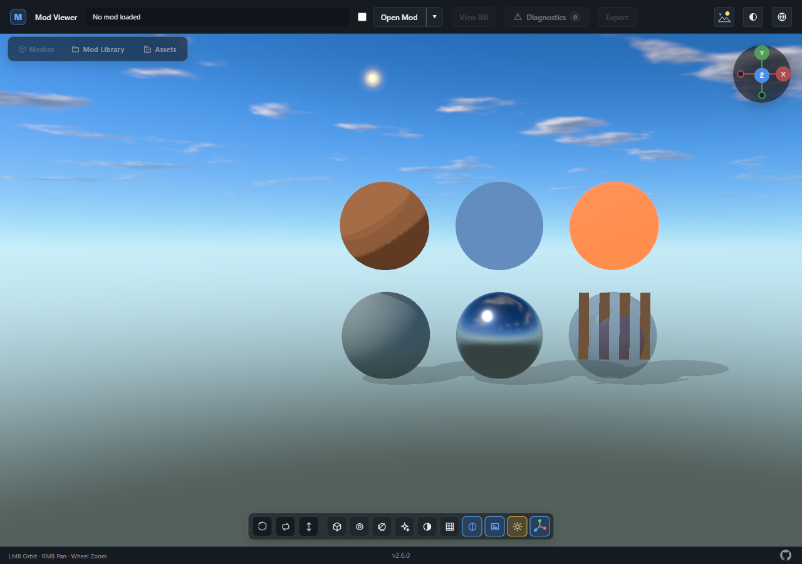
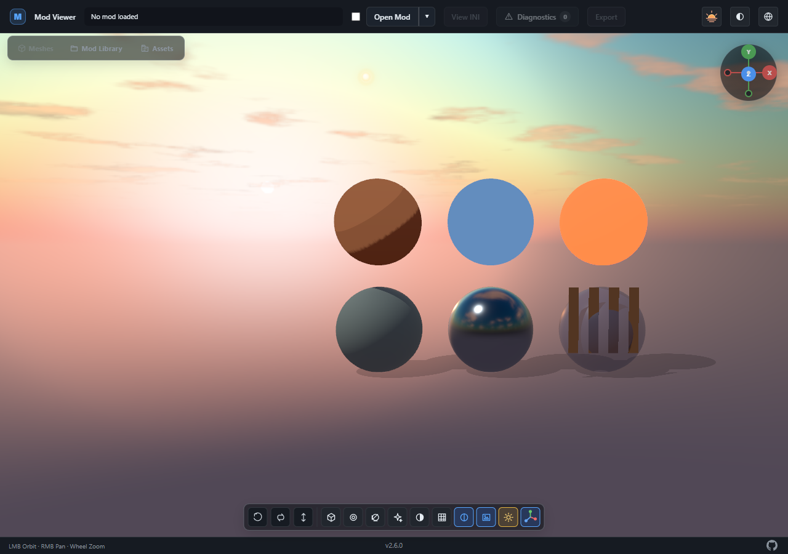

# Atmospheric environments

Outdoor and Sunset share the existing Three.js WebGPU renderer and SkyMesh
scattering model. A frozen atmosphere configuration supplies the sun direction,
sun color/intensity, scattering, cloud coverage/density and sky exposure.
Directional sunlight follows that direction independently of the movable
inspection light. Hemisphere and ambient fill keep inspection materials readable.

Static clouds use MaterialX fractal noise from the vendored TSL library, with
sunward density sampling for shading, illuminated edges, and filtered silhouettes.
Clouds fade into atmospheric haze at the horizon. The lower hemisphere blends
into a preset ground color. Neither preset adds distance fog to model meshes.
SkyMesh's built-in cloud blend is disabled so there is only one cloud layer.
The approach was informed by studying
[web-ocean's atmosphere and clouds](https://github.com/Noniv/web-ocean/blob/main/js/wgsl/sky.js);
no source code or renderer was imported from that project.

Each sky is captured once into a 1024-pixel half-float cubemap. That same texture
supplies the viewport background and a 256-pixel PMREM capture. Highlight
compression happens in linear space during sky capture; model materials retain
the existing sRGB output, NoToneMapping, AO and emission-only bloom behavior.
The sky never joins the model scene graph, so model bounds, selection, outlines,
rigging, AO geometry and camera clipping do not need sky-specific exclusions.

Environment resources are generated on first use, after renderer initialization.
An unselected queued preset is skipped. Immutable configurations need no frame
updates or cache invalidation; replacing the controller rebuilds its resources.
Revisiting a preset reuses its targets. Disposal restores the original background,
environment and lights and releases all owned targets and generator resources.
Page teardown releases the controller, while a preserved browser page keeps it.

## Reproducing visual and performance comparisons

Install the repository development dependencies, populate its vendored assets,
and use a compatible Edge/WebGPU environment. From the repository root:

```sh
python tools/benchmark_environments.py --output .quality-reports/environments-current
python tools/benchmark_environments.py --environment-ref <baseline-ref> --output .quality-reports/environments-baseline
```

The second command substitutes only the older environment module; the checkout,
scene, camera, materials, browser arguments and output dimensions stay identical.
Use the same device and settings, and compare multiple runs. Each run starts a
new browser and captures every preset in direct, AO, bloom and combined modes.
The synthetic scene includes diffuse/normal, metal/gloss, transparency/cutout hair,
toon, unlit and emissive surfaces, with character shadows and AO.

Reports contain renderer startup, first activation, cached switching, camera
movement, renderer allocation estimates and idle render/shadow counts. Frame
latency includes browser scheduling and completion of the GPU queue; it is not
an isolated GPU execution time. Allocation counters are Three.js estimates, not
hardware VRAM telemetry. First activation includes shader/capture preparation;
compare it separately from cached switching. Startup with Default should create
no environment maps, and idle scenes should submit no viewport or shadow work.
Compare allocation counts before/after cached switching to check resource reuse.

Illustrative captures use only generated geometry and textures:

| Original Outdoor | Outdoor | Sunset |
| --- | --- | --- |
|  |  |  |

Default, Studio and Indoor can be compared pixel-for-pixel across matching runs.
The focused browser lifecycle test also exercises empty scenes, model replacement,
all four viewport paths, preset restoration, camera scale/clipping, resize,
the view gizmo and mesh selection. The module lifecycle test covers shared sun
direction, skipped work, resource reuse, failure cleanup and disposal.

These browser checks and the comparison tool are explicit local tools. GitHub CI
continues to run the quality audit and unit/core/app/integration tests without
enabling browser or GPU tests.
