# Geometry rig experiment — Iterations 2 and 3

Iteration 2 fixes the lower-face neck placement and removes clothing-taper knee
detection and surface-driven hip widening. Odette's frontal wrist residuals
decrease modestly. Shoulders, elbows, feet, and Chisa's successful wrists retain
their Iteration 1 positions exactly. The result remains a temporary geometry
preview; it does not replace production Rig, binding, deformation, production IK, Physics,
Weight, or saved poses. Hidden joint depth is still uncertain.

## Evaluation and uncertainty

The same displayed Remielle, Odette, and Chisa variants are evaluated without
textures or Weight. The [frozen baseline](iteration-1/README.md) was captured
before anatomical fitting changed. The original perspective measurements and
guides are retained as `iteration-1/legacy-measurements.json` and
`iteration-1/legacy-guides.json`; the original six images remain in this folder.
Perspective and orthographic residuals are separate evaluations.

The tool now uses front and left-side orthographic cameras aligned to the
character's right/up/forward axes, with identical height normalization and
camera settling before measurement. The same existing overlay displays the
proportional, Iteration 1, and Iteration 2 positions. Camera direction never
enters the fitter, and no application UI controls were added.

Each of the 16 guide entries classifies **each view** independently:

- **Visible:** an approximate silhouette landmark; front uncertainty is about
  1% of character height and side uncertainty about 1.5%.
- **Estimated:** an anatomical estimate or a broad silhouette envelope,
  useful for plausibility rather than positional accuracy.
- **Indeterminate:** clothing or occlusion prevents a defensible reference.

Only visible guides receive error measurements. Estimated and indeterminate
rows retain null errors. Segment proportions, joint alignment and bilateral
height/depth differences are recorded for plausibility review. The side neck
envelope is broad enough to describe the neck silhouette; it cannot establish
an exact internal spine joint. Confidence means **surface evidence strength**,
not verified anatomical accuracy. The guides were frozen before runtime
algorithm changes and are never inputs to the fitter.

## Measured changes

All numbers are projected distances as percentages of character height.
Triples are **proportional / Iteration 1 / Iteration 2**. Bilateral values are
averages. Small residual changes within guide uncertainty are classified as
stable, rather than proof of improved anatomy.

| Front visible control | Remielle | Odette | Chisa |
| --- | ---: | ---: | ---: |
| Neck | 0.94 / 3.40 / 0.87 | 0.13 / 1.08 / 0.30 | 1.05 / 2.79 / 0.54 |
| Shoulder | 4.61 / 0.85 / 0.85 | 4.96 / 0.80 / 0.80 | 3.29 / 0.48 / 0.48 |
| Wrist/hand | 3.12 / 1.30 / 1.34 | 1.10 / 1.68 / 1.06 | 5.05 / 0.65 / 0.65 |

Neck improvement exceeds frontal guide uncertainty for Remielle and Chisa.
Odette's neck returns near the proportional location, although its original
proportional residual is still smaller. Odette's wrist improvement is below
manual-guide uncertainty, so it is a promising numerical change, not a strong
accuracy claim. Remielle's small wrist residual change is also below that
uncertainty; the controls remain on the forearm and before the hand extremity.

| Side visible control | Remielle I1 → I2 | Odette I1 → I2 | Chisa I1 → I2 |
| --- | ---: | ---: | ---: |
| Near wrist/hand | Indeterminate | 1.28 → 1.31 | 0.25 → 0.25 |
| Near foot | 1.30 → 1.30 | 0.58 → 0.58 | 0.91 → 0.91 |

The small Odette side wrist change is well below side-guide uncertainty. The
former Remielle and Chisa necks lie above the broad side neck envelope; the
updated necks are inside it. No visible-guide regression exceeds uncertainty
in either view. This does not establish hidden hip/knee or occluded-arm depth.

The [measurements](measurements.json) identify improvements, regressions,
stable changes, and uncertainty without comparing rows by hand. Detailed
[Remielle](iteration-2/remielle.json), [Odette](iteration-2/odette.json), and
[Chisa](iteration-2/chisa.json) captures retain all 16 positions in both views,
evidence, individual residuals, and three-dimensional plausibility measures.

## Front and side comparisons

| Model/view | Proportional | Iteration 1 | Iteration 2 |
| --- | --- | --- | --- |
| Remielle front | 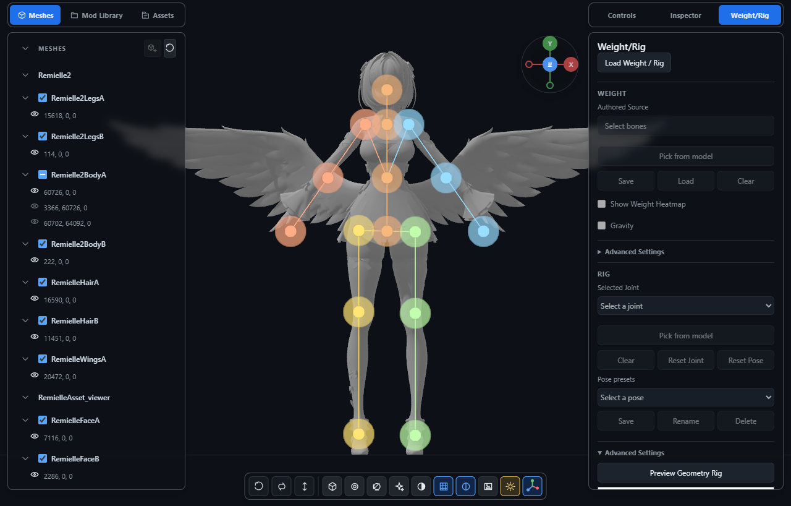 |  | 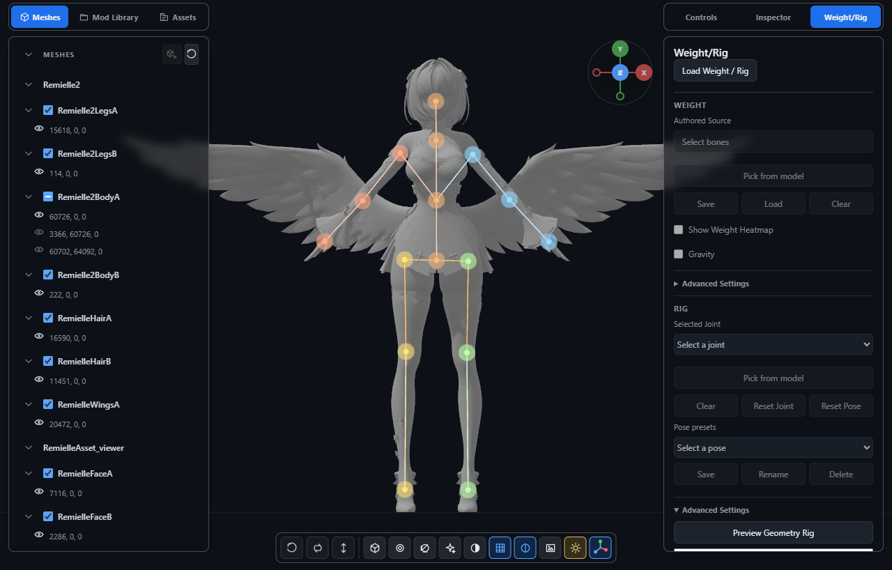 |
| Remielle side |  | 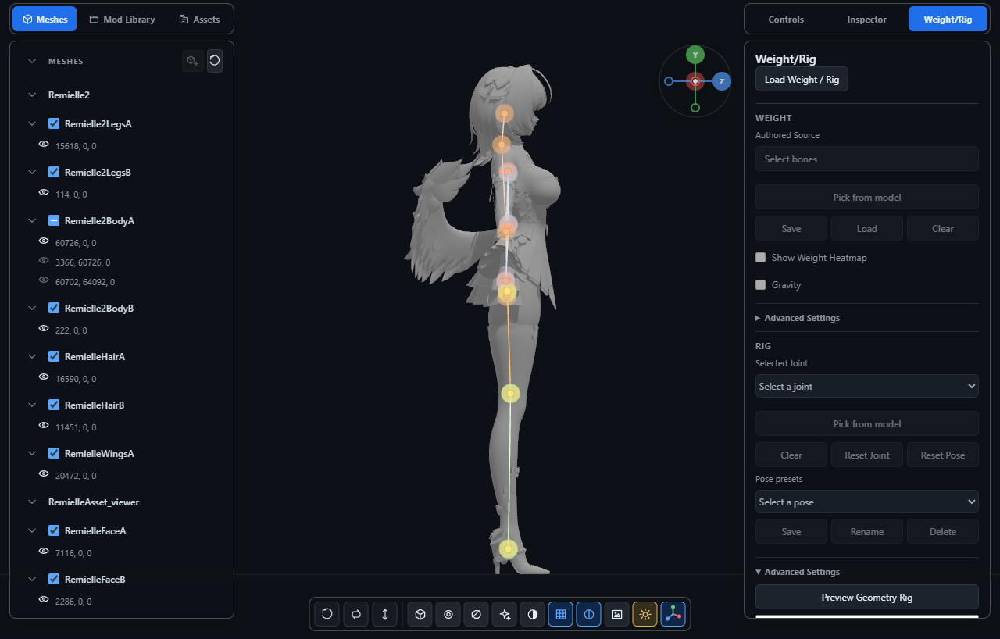 |  |
| Odette front | 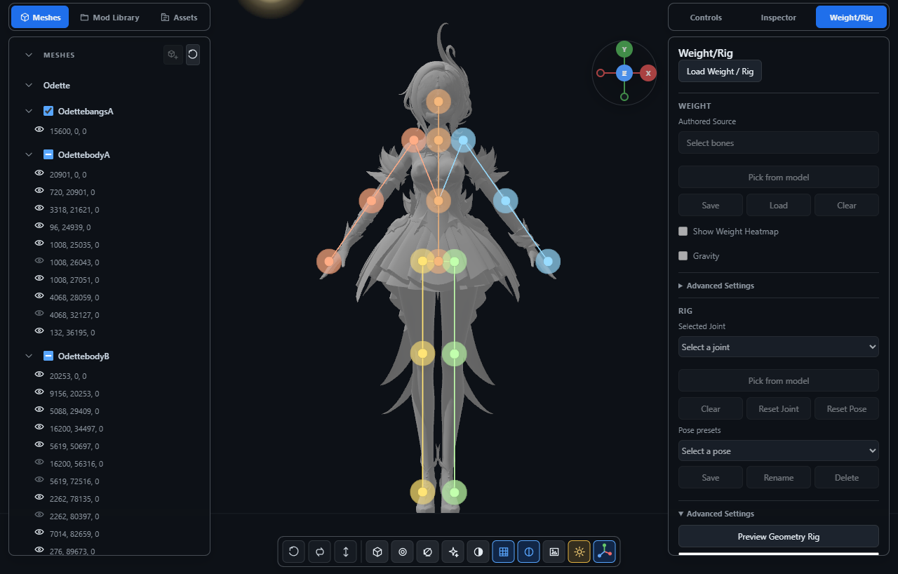 | 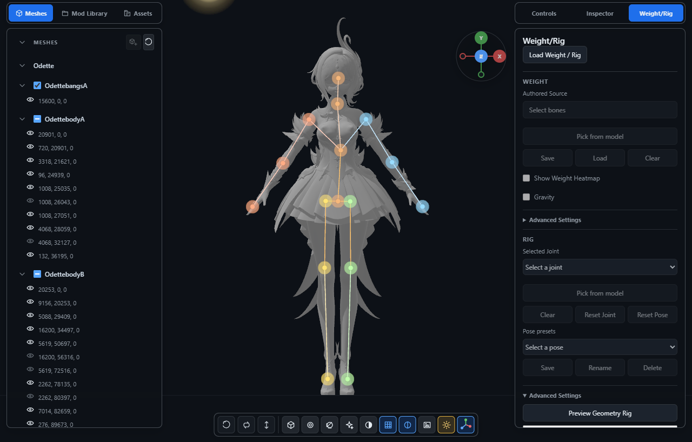 |  |
| Odette side | 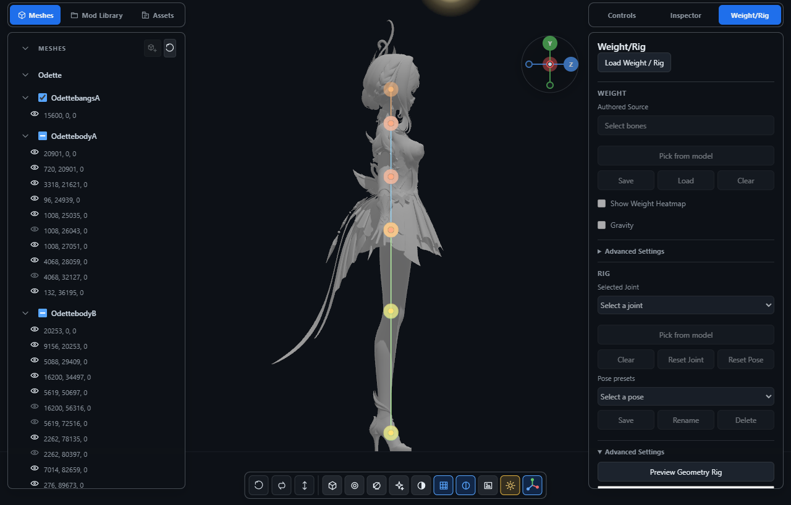 |  |  |
| Chisa front | 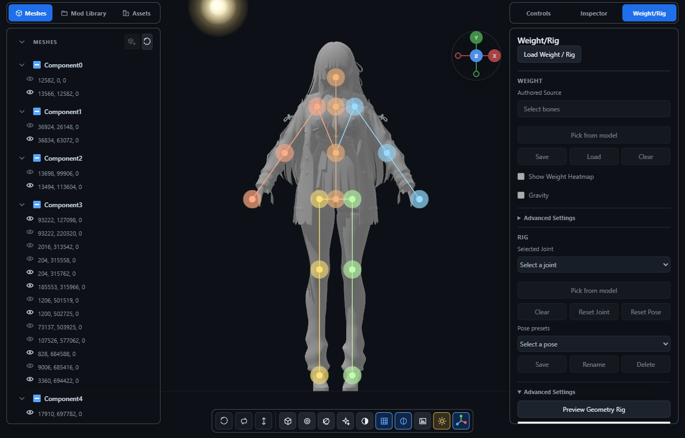 |  | 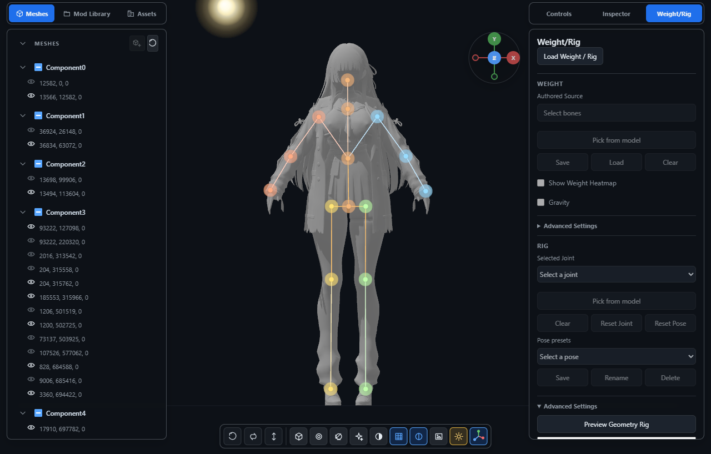 |
| Chisa side |  | 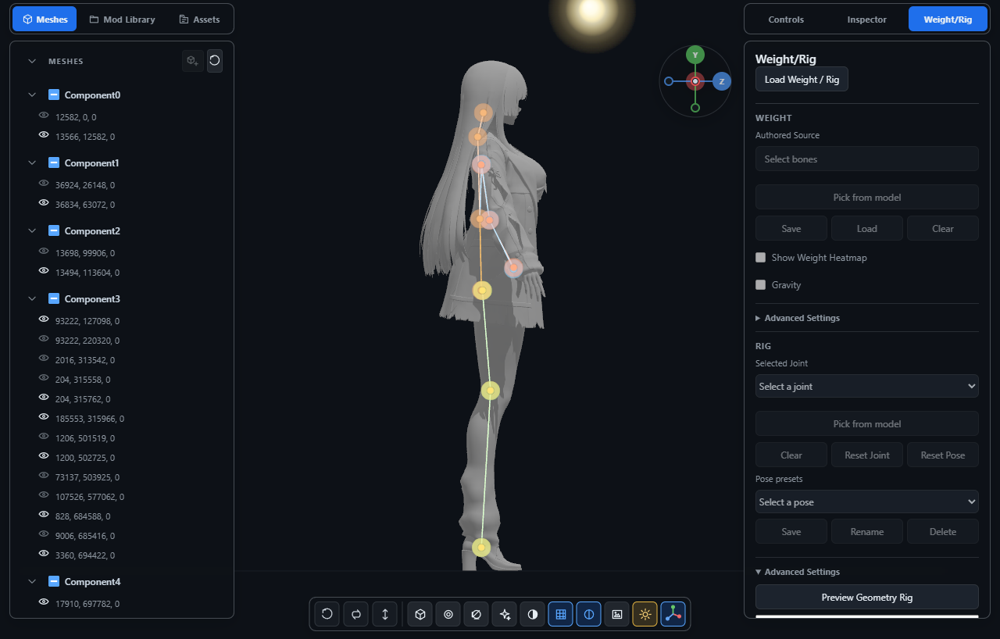 |  |

## Anatomy and remaining limitations

The neck uses the shoulder-to-head relationship and consistent upper-torso
sections in three dimensions. A single narrow face section no longer controls
its height. The wrist uses distal forearm direction, the hand expansion and
anatomical length constraints; it no longer chooses the narrowest sleeve.
Shoulder and arm-path detection are unchanged.

Leg evidence is traced upward from each foot. Only continuous, bounded
three-dimensional sections can refine the hip/knee centerline. Segment
relationships retain plausible joint heights; width taper is never a knee
detector. Hidden hips remain at the proportional estimate on all three models.
The largest knee departures from that estimate are 0.44% of height for Remielle,
0.23% for Odette, and 0.75% for Chisa. These small corrections describe supported
limb alignment, not a measured internal knee. A synthetic skirt with obscured
thighs leaves hip/knee positions at their anatomical estimates.

Remielle's wings do not become hand endpoints. With wings hidden, shoulder
positions exactly match the stored Iteration 1 hidden-accessory fit. Accessory
visibility still changes surface normalization: central height changes by
0.89%, and the largest full-versus-hidden control shift is 2.25% of height.
This existing sampling sensitivity should not be confused with an Iteration 2
arm regression. The [accessory capture](iteration-2/remielle-hidden.json)
records both views and its comparison with the original hidden-accessory fit.

Chisa's 24 inactive meshes remain excluded. Independent duplication of every
displayed mesh causes zero control displacement. Approximately symmetric
height/depth relationships are retained. Exact duplicate draws and triangles
are removed; spatial occupancy mitigates other overlap. Differently triangulated
overlapping surfaces still need not produce identical samples.

## Workload and performance

| Model | Displayed/inactive meshes | Displayed triangles | Deduplicated draw triangles | Examined / unique triangles | Area samples / retained points | I1 → I2 observed fit |
| --- | ---: | ---: | ---: | ---: | ---: | ---: |
| Remielle | 10 / 2 | 45,285 | 45,285 | 45,285 / 45,279 | 16,000 / 15,706 | 0.41 → 0.42 s |
| Odette | 35 / 10 | 75,131 | 72,346 | 72,346 / 72,165 | 16,000 / 15,554 | 0.64 → 0.61 s |
| Chisa | 19 / 24 | 145,749 | 145,749 | 90,000 / 90,000 | 16,000 / 15,619 | 0.76 → 0.70 s |

These sequential observations use the same browser and hardware, with cold
viewer loads. They are illustrative rather than a statistically controlled
benchmark. The 90,000-triangle and 16,000-area-sample caps and cooperative
yielding remain unchanged. Displayed counts include repeated draws; exact-draw
deduplication precedes the scan, triangle deduplication follows it, and spatial
occupancy produces retained fitting points. This reconciles the earlier report's
incorrect use of Odette's displayed count as its examined count.

## Reproduce and review

```text
python tools/evaluate_geometry_rig.py <mod-folder> --output <report-folder> --guides docs/experiments/geometry-rig/<model>-guides.json --baseline docs/experiments/geometry-rig/iteration-1/<model>.json
```

Use `--check-duplicates` for duplication testing and `--hide Wings` for the
accessory comparison. The read-only bridge fixture opens the existing viewer,
captures both views and three skeletons, and writes `comparison.json`. It does
not change mod files or load skinning data. A compatible local WebGPU browser
is required. Hiding geometry changes the normalization frame; compare that
capture with the matching hidden-accessory baseline when interpreting errors.

Static previews use existing pose/edit/Physics ownership state instead of
scanning every live vertex. Animated participants retain a conservative rest
comparison. Pending fits reject changed geometry buffers, draw ranges, rest
arrays, visibility, and transforms. Relevant mesh/transform events clear
completed previews. Results remain temporary, and explicit requests rerun fitting.

Focused coverage checks neck/head/shoulder relationships, wrist alignment,
skirt uncertainty, orientation, topology, duplicates, Weight-free preview,
cancellation, restored controls and model switching. The existing CI quality
audit and unit/core/app/integration selection are unchanged.

## Iteration 3 — skeleton-only posing

This section preserves the initial `a5f2cbe` evaluation. The review follow-up
below records the revised preferred planes and return-to-rest behavior.

**Test IK**, **Reset Pose**, and **Flip Bend** extend the existing preview under
Rig Advanced Settings. Drag a hand or foot to solve its two-bone chain with
`solveHumanoidControlIk()`. The shoulder/hip stays fixed, other temporary limb
poses remain intact, and the existing markers and connections update in place.
Geometry and Proportional both support posing; changing modes starts from that
skeleton's rest positions. The fitted rest controls remain authoritative and
unchanged. No Weight, ModelRig, binding, deformation, preset, or metadata state
is involved. Camera orbit resumes when dragging ends.

Bend directions are frozen from the fitted rest-joint geometry. Nearly straight
limbs use the anatomical forward axis: elbows toward the back, knees toward the
front. The camera does not determine bend direction. Flip Bend reverses only
the selected limb. Reset, disable, Current Rig, panel closure, regeneration,
model switching, geometry changes and model transforms clear temporary poses
or interactions as appropriate. Pointer cancellation and capture loss restore
camera controls without acquiring production transform/deformation ownership.

### Standardized movement comparison

All four limbs of the same three displayed variants were tested with identical
height-normalized displacements applied separately to each skeleton. Hands and
feet move inward by 0.04 height and upward by 0.12, with either +0.12 or -0.12
along anatomical forward. A third target extends each endpoint outward by 0.25
height along the geometry rest-chain direction; the same displacement vector is
also used for the proportional and reference comparisons. Each path has 40
steps and a return to the rest endpoint. Camera orientations and orthographic
scale match the static evaluation.

The compact [pose measurements](iteration-3/measurements.json) retain aggregate
invariants, segment lengths, endpoint reachability/residuals, bend orientation,
and return-to-rest differences. They contain no per-frame geometry snapshots.

| Check | Remielle | Odette | Chisa |
| --- | ---: | ---: | ---: |
| Forward/backward targets reached, geometry and proportional | 8 / 8 | 8 / 8 | 8 / 8 |
| Beyond-extension targets clamped, geometry and proportional | 4 / 4 | 4 / 4 | 4 / 4 |
| Largest segment-length error / height, including reference cases | < 3e-16 | < 3e-16 | < 3e-16 |
| Anchor / unrelated-limb displacement | 0 / 0 | 0 / 0 | 0 / 0 |
| Unexpected bend-sign changes in sampled paths | 0 | 0 | 0 |
| Weight requests / ModelRig loaded | 0 / no | 0 / no | 0 / no |
| Fitted rest / active geometry unchanged | yes / yes | yes / yes | yes / yes |

Counts above are per skeleton, with matching outcomes for Geometry and
Proportional. All control positions remained finite. Elbows bent backward and
knees forward relative to the solved chain in both forward/backward target
cases. Chains stayed connected to their anchors and endpoints, with no segment
stretching or pose leakage into other limbs. Chisa duplicate displacement
remains zero. Its count is **19 displayed + 24 inactive = 43 meshes**; the earlier
Iteration 2 prose/table incorrectly said 32 inactive, while the capture JSON
already recorded 24. The count correction does not change fitting inputs.

Near full extension, the two-bone solution is sensitive to small endpoint
movements. Maximum middle-joint travel between the 40 sampled steps is about
2.8% of height for the ordinary geometry/proportional cases, and 3.3% including
reference-plane comparisons. This is not a universal continuity guarantee.
Returning an endpoint to its rest target yields a deterministic constrained
pose; anatomical fallback planes can leave the middle joint slightly off its
fitted rest point (up to 1.01% height for Remielle, 0.86% for Odette, 0.08% for
Chisa). **Reset Pose** restores the fitted controls exactly.

Each image uses the same cropped viewport and scale. Rows 1–3 compare
Proportional (left) and Geometry (right): front toward, side toward, and side
away. Row 4 shows temporary corrected-reference joints from front and side.
The mesh intentionally remains in its A-pose throughout.

| Remielle | Odette | Chisa |
| --- | --- | --- |
| 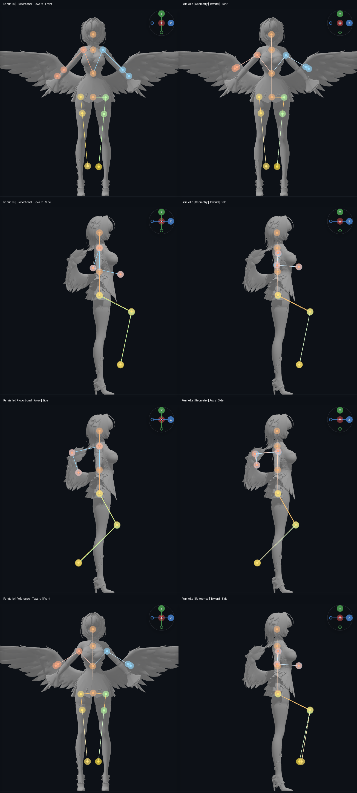 | 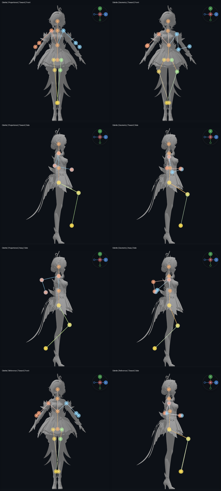 | 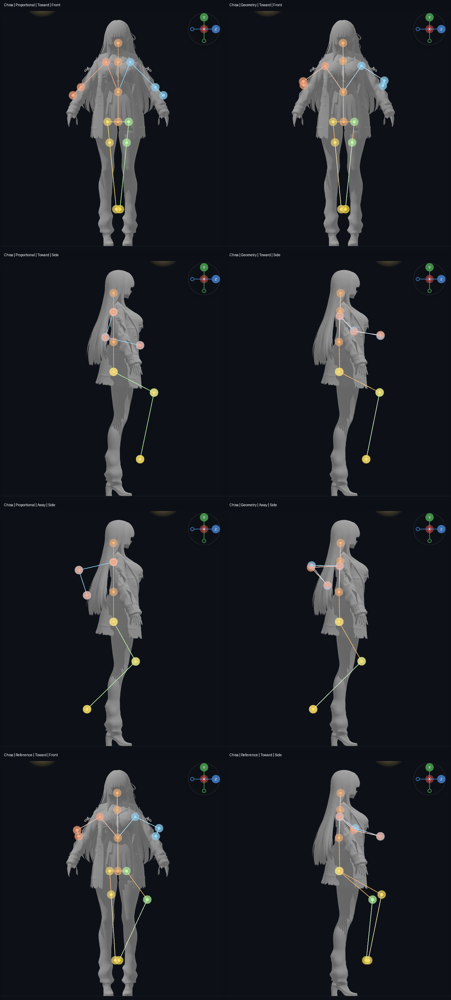 |

### Separating joint placement, bend plane and solver behavior

Temporary reference controls use the existing manual frontal visible/estimated
guides and meaningful visible side guides; other depths remain unchanged.
Hidden hip/knee corrections are anatomical hypotheses, not ground truth. They
exist only in the evaluation fixture and never enter the runtime fitter or a
permanent editor. A second reference run holds the original geometry bend
directions fixed while correcting the joints, isolating plane-selection effects.

Odette's geometry arms respond asymmetrically: in the forward target, elbow
offsets behind their solved chains are 8.11% and 3.15% of height. Corrected joints
with recalculated rest planes yield 8.57% and 7.90%; retaining the original
planes yields 8.57% and 3.12%. Most of the right-arm imbalance therefore comes
from the bend plane inferred from the imperfect rest joints, rather than a
segment-length or reachability failure in the unchanged IK solver. Remielle's
arms remain comparatively balanced; Chisa's response changes with target depth
but remains bilateral and stable. The more symmetric proportional response
does not prove its joint centers are more accurate.

Dress and trouser geometry still prevents confident judgment of internal hip
and knee pivots. The controls move consistently, but this experiment cannot
establish natural mesh bending. Odette's rest-plane ambiguity and uncertain
internal pivots warrant review before a controlled deformation experiment.
No IK solver changes were made to compensate for inaccurate joints.

```text
python tools/evaluate_geometry_rig.py <mod-folder> --output <report-folder> --guides docs/experiments/geometry-rig/<model>-guides.json --poses
```

The existing lifecycle scenario now checks four endpoint gestures, marker reuse,
camera orbit, reset/flip, reach clamping, rest/geometry immutability, mode changes,
capture cleanup, model switching and rest-geometry invalidation. Production
overlay, Weight activation and locale checks remain separate existing coverage.
Keep PR #180 open and unmerged for review.

## Iteration 3 review — preferred planes and exact rest return

This section records `faee3b5`. The fine-interaction check in Iteration 4 below
supersedes its 2%-of-height transition distance; these measurements and captures
remain the review baseline.

Preferred planes now require rest-joint evidence with perpendicular displacement
of at least 10% of **each** segment length and at least 0.5 alignment with the
projected anatomical bend direction. Weak, nearly straight or anatomically
conflicting evidence uses the anatomical orientation instead. This avoids the
old character-height cutoff accepting a misleading small elbow offset. Chisa's
stronger, anatomically consistent arm evidence remains usable. The preferred
directions stay fixed throughout posing and do not depend on camera or pose
history. The fitter and existing two-bone solver remain unchanged.

Within 2% of character height of the rest endpoint, the plane rotates smoothly
from fitted rest evidence toward the preferred direction as target distance
increases. This deterministic transition preserves continuity while allowing the
original rest joint to be recovered. Returning exactly to the rest endpoint
restores the fitted middle joint and endpoint exactly, including after Flip Bend;
the flipped preference applies again when moving away. Reset Pose still clears
all temporary poses. Segment lengths, anchors and unrelated limbs remain intact.

The Rig event handler restores disabled-control state before synchronizing Weight
and Physics, then synchronizes Rig and Geometry Preview once. This removes the
duplicate preview refresh while retaining the existing event and panel ownership.
The 200-solve probe in `tools/evaluate_geometry_rig.py --poses` records one pose
status write per solve, down from two. In the paired probe, median synchronous
solver/panel/overlay update cost was about 0.4 ms before and after; the observed
95th percentile was about 0.5 and 0.6 ms. These timings exclude rendering and vary
with the browser runtime; the result supports removing duplication without
introducing another event architecture.

### Repeated movement evaluation

The [compact review measurements](iteration-3-review/measurements.json) use the
same normalized targets, rest fits, camera scale and displayed variants as the
initial comparison. Each movement now includes 40 outward and 40 return steps,
so continuity checks cover the rest transition as well as full extension.

| Geometry check | Remielle | Odette | Chisa |
| --- | ---: | ---: | ---: |
| Forward-target elbow offsets backward, left / right | 7.00% / 6.95% | 8.11% / 8.06% | 3.51% / 3.60% |
| Largest rest-return joint error / height | 0 | 0 | 0 |
| Largest joint step / height, outward and return | 2.49% | 2.14% | 2.27% |
| Unexpected bend-sign changes | 0 | 0 | 0 |

Geometry and Proportional still reach 8/8 forward/backward targets and clamp 4/4
overextension targets per model. Segment-length errors remain below 3e-16 height;
anchor and unrelated-limb displacement remain zero. All controls remain finite,
including the corrected-reference comparisons. Consecutive bend directions stay
aligned throughout the sampled paths; preferred-plane alignment is measured
outside the rest-transition neighborhood. These are sampled continuity results,
not a guarantee for arbitrary targets. Rest controls and active mesh geometry
remain unchanged, Weight requests remain zero, and no ModelRig is loaded. Chisa
still has 19 displayed and 24 inactive meshes, with zero duplicate displacement.

Odette's original 8.11% / 3.15% elbow response becomes 8.11% / 8.06% without
correcting any joint position. The image preserves the same viewport crop and
scale: original front/side views above, revised front/side views below.

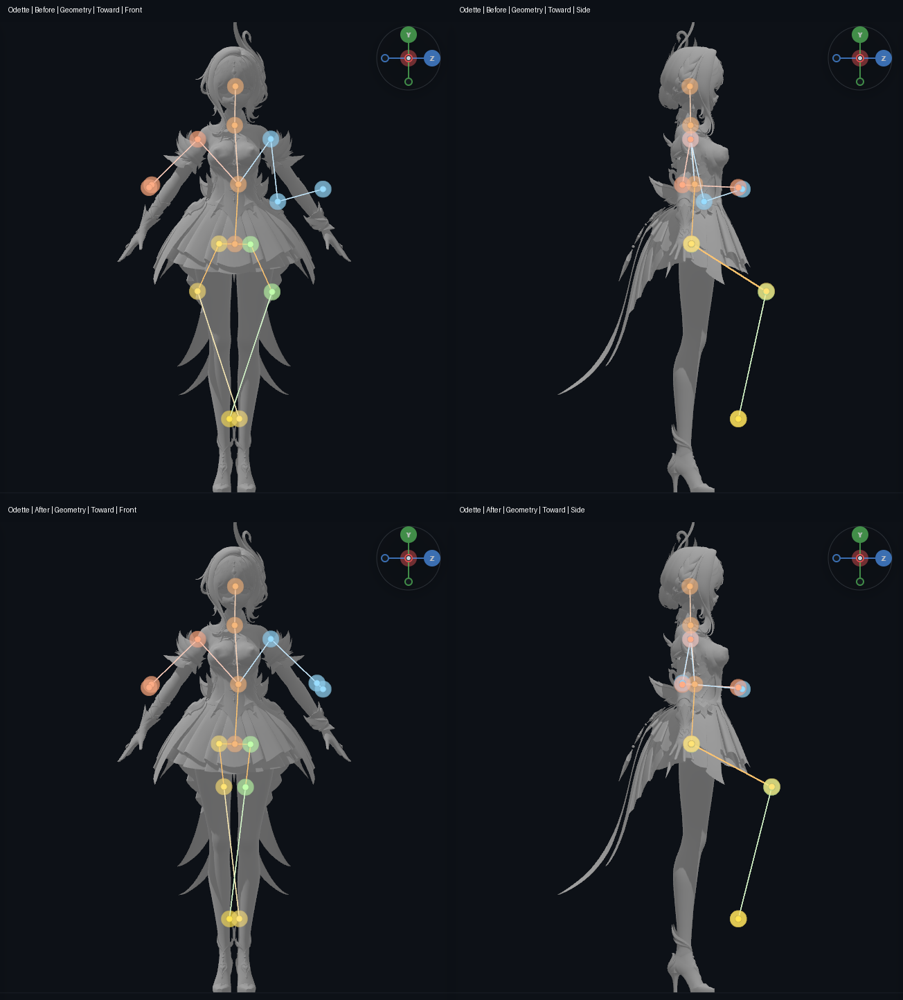

The existing lifecycle scenario now also checks weak, strong and conflicting
rest-plane evidence, exact rest return after a flip, a continuous rest approach,
near-full-extension continuity and history-independent target solutions. No new
UI or production Weight, skinning, deformation, reconciliation or persistence
behavior is introduced. The bend-plane issue is addressed in these comparisons;
occluded internal pivots and natural mesh deformation still require separate
evaluation. Keep PR #180 open and unmerged.

## Iteration 4 — fine hand interaction and one-arm deformation

The updated review requested actual hand drags near rest before deformation.
The check uses both hands on Remielle and Odette, front and oblique views, four
screen directions, and both default and flipped bends. Each of the 32 paths per
model moves the pointer through 2% of character height in 20 steps and returns
in 20 steps. Selection, drag acquisition and camera release are checked through
the existing pointer handlers. The model remains in its A-pose for this check.

The `faee3b5` captures show the elbow sweeping back across its initial arc while
the hand continues inward. The fitted and preferred planes can differ by roughly
90–111 degrees; completing that rotation inside a 2%-of-height neighborhood is
too abrupt for fine adjustments. The existing smooth transition now spans one
quarter of the limb's total reach. It retains the same preferred-plane criterion,
exact rest restoration and history independence. No fitter, solver, camera-based
rule or additional interaction UI is introduced. This is a preview transition
scale, not an anatomical accuracy claim or a universal motion guarantee.

| Fine-drag check                              | Remielle             | Odette               |
| -------------------------------------------- | -------------------- | -------------------- |
| Pointer paths, including Flip Bend           | 32                   | 32                   |
| Largest bend-plane turn in the revised paths | 24.87°               | 24.19°               |
| Largest elbow displacement, before → after   | 4.82% → 4.45% height | 5.49% → 4.12% height |
| Rest-return error                            | 0                    | 0                    |
| Weight requests / loaded ModelRig            | 0 / no               | 0 / no               |

The before/after strips show the same inward hand movement from rest through
0.5%, 1%, 1.5% and 2% of height, including Flip Bend. The revised elbow motion is
more gradual. Near full extension, even a small inward target change can still
produce a larger joint displacement because fixed-length segments must bend.

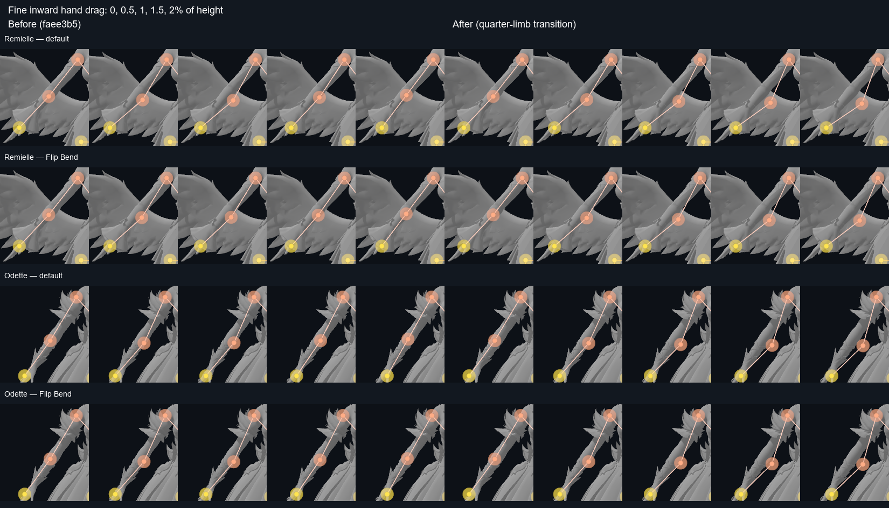

The repeated skeleton-only comparisons retain Odette's 8.11% / 8.06% forward
elbow offsets and zero rest-return error on all three models. The saved paths
remain finite, preserve segment lengths and anchors, and show no unexpected
bend-sign changes. Chisa's duplicate displacement remains zero. The existing
lifecycle coverage also checks a fine inward adjustment before and after a flip.

### Controlled left-arm deformation

After inspecting the revised hand drags, the experiment proceeds with only
Remielle's left arm. `tools/evaluate_geometry_arm.py --deform-left-arm` first
fits the independent geometry skeleton, then decodes the retained authored Blend
streams. It reuses the existing source-graph construction, ModelJoint
reconciliation, binding and position/normal deformation helpers in a disposable
evaluation session. Authored indices and weights are unchanged and unnormalized.
Only transforms belonging to `left_upper_arm` and `left_lower_arm` are applied;
other influences retain their authored rest contribution.

#### Review correction — independent IK and fixed edge samples

The `08b1791` evaluator incorrectly assigned a selected rig to the snapshot
returned by `getModelRigState()`. The real preview continued solving the Geometry
Rig, so the Current comparison applied geometry-derived poses to proportional
rest drivers. Those earlier deformation results are invalid as a comparison of
skeletons. The near-rest interaction correction above remains unchanged.

The comparator is the current automatic humanoid Rig, constructed with the same
anatomical axes and the existing weight-inferred ModelJoint binding. Its control
positions currently use the proportional geometry template; it is not a new
skeleton inferred from weights for this experiment. Geometry generates its
controls before skinning data is loaded; deformation still relies on the existing
weight-inferred ModelRig for influence mapping. This does not establish an
independent geometry-to-deformation pipeline.

Each mode now calls the unchanged `solveHumanoidControlIk()` directly with its
own immutable control rig. Its shoulder, elbow and hand define its own segment
lengths. Both calls use the same anatomical arm policy: negative forward,
projected perpendicular to that rig's resting shoulder-to-hand direction. This
keeps the large-pose bend policy comparable without introducing fitting rules.
The shared Geometry frame height normalizes the target displacement: 0.12 up
plus or minus 0.12 forward from each rig's own hand. The solver's existing fallback
remains available if that bend input degenerates. No preview state is assigned or
posed by the deformation evaluator.

The measurements record each mode's actual rest controls, target, bend input,
solved controls, segment lengths and residual. Current's upper/lower lengths are
0.27537 / 0.27537 model units; Geometry's are 0.22284 / 0.20366. Both targets are
reached with fixed anchors and lengths. The Geometry deformation results match
its earlier run; Current now uses its own pose. Its changed-edge p95 shifts from
1.49 to 1.46 forward and from 1.87 to 2.11 backward. These separate changed-edge
sets remain debugging diagnostics, not the basis for comparing quality.

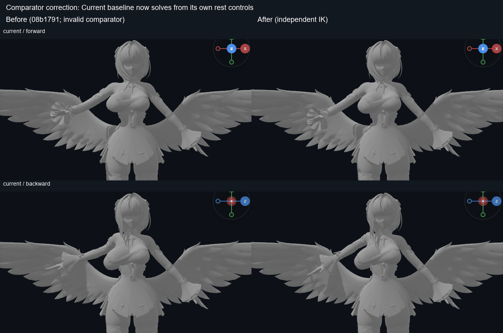

For comparison, both modes now use one frozen rest-space arm region: the union of
capsules around both skeletons' shoulder/elbow/hand chains, with radius 8% of the
shared height. This is a geometric proxy for the arm and shoulder region, not an
authored anatomical label. An edge qualifies when both endpoints lie inside the
region. Only displayed triangles participate; edges are deduplicated per draw,
and rest edges shorter than 0.001% of height are excluded. The same 16,785 edges,
including unchanged edges, are evaluated for every pose. Counts by draw and a
SHA-256 digest of mesh/vertex edge identities verify the common sample. The
envelope also intersects nearby hair and face geometry; its percentile must be
read alongside local extrema and the images. The camera frame and crop are
shared, and the overlay is hidden only in mesh-quality captures.

| Corrected deformation check                          | Current automatic Rig | Geometry Rig |
| ---------------------------------------------------- | --------------------- | ------------ |
| Arm-bound ModelJoints                                | 57                    | 46           |
| Moved vertices, including inactive draws             | 11,880                | 9,418        |
| Moved displayed hair vertices                        | 951                   | 0            |
| Moved vertices in the draw labeled LegsA              | 5                     | 5            |
| Forward common-region edge ratio, p95 / maximum       | 1.21 / 3.35           | 1.02 / 4.56  |
| Backward common-region edge ratio, p95 / maximum      | 1.45 / 7.71           | 1.02 / 5.73  |
| Forward / backward minimum common-region edge ratio | 0.40 / 0.11           | 0.38 / 0.23  |

Edge ratios compare posed and authored rest lengths. Ratios below one also
identify compression. These diagnostics are not anatomical ground truth or a
natural-deformation score. Moved vertices use a 0.0001%-of-height cutoff;
displayed counts cover vertices actually referenced by the displayed draw range.

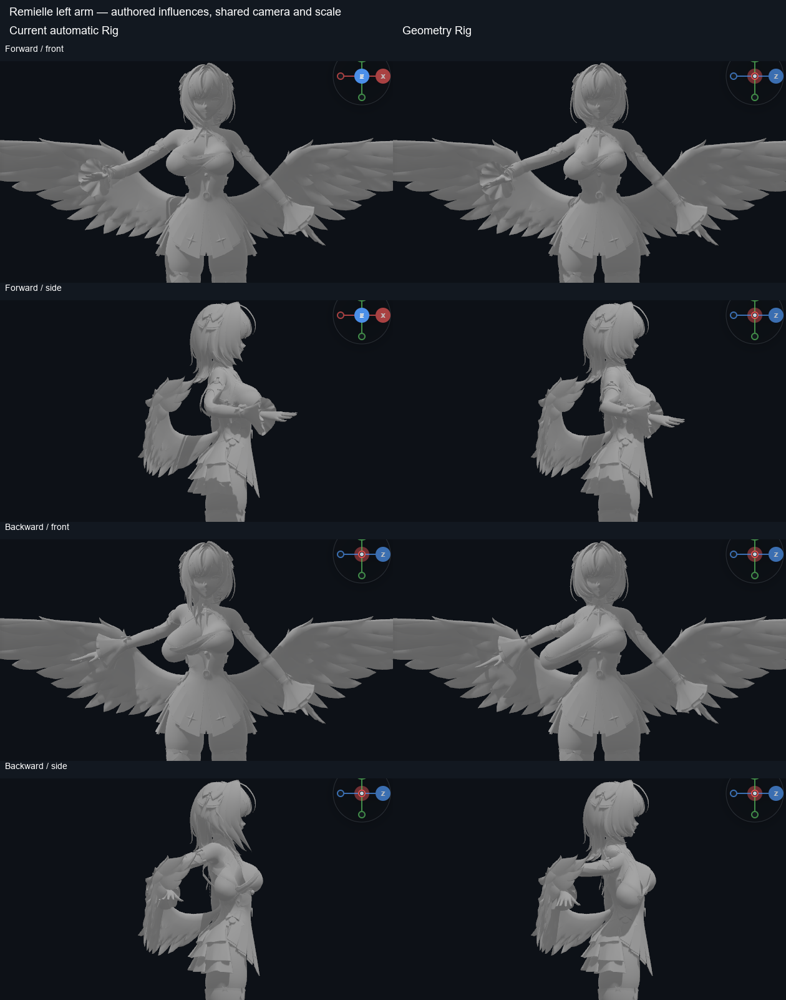

Both forward and backward targets are reached and all output positions/normals
are finite. Vertices with no bound-arm influence remain fixed. Returning to rest
restores positions and normals exactly, and neither fitted controls nor authored
influences change. A neutral scenario exercises the evaluator itself with two
different rest skeletons, checks each solved chain and the common edge identities,
traces source-scoped influences, and verifies exact position/normal restoration.
The production Weight UI and ModelRig remain inactive; the evaluation explicitly
reads skinning data outside that UI.

#### Influence ownership findings

The [source-to-driver trace](iteration-4/ownership-trace.json) records every
moving displayed influence, its source descriptor, ModelJoint members and pivot,
both modes' assigned drivers, inheritance chain, per-pose counts and up to five
authored vertex samples. It keeps source identity with each numeric bone ID.

The five vertices in `Remielle2LegsA-1` are authored vertices 128, 135, 141, 142
and 738. They carry source influence 14 in `remielle2legsblend.buf|offset=0`,
with weights of 0.38–1.21%. Reconciliation groups it with influence 131 in
`remielle2bodyblend.buf|offset=0` as ModelJoint 37. Both bindings assign this joint
directly to `leftShoulder` / `left_upper_arm`. Their rest positions are at
76.9–78.9% of height, near the upper torso; the draw's name is not evidence of
leg anatomy. The earlier description of these five vertices as leg leakage was
unsupported. No mesh-name exclusion is warranted by this observation.

The Current binding assigns ten influences from `remiellehairblend.buf|offset=0`
directly to the upper-arm driver. Their pivots lie within 2.98–7.57% of height from its shoulder control,
inside the existing point-ownership radius. Geometry assigns those same
ModelJoints to head or neck drivers, which remain at rest in this arm experiment.
This traces the 951 moving hair vertices to ownership, independently of the
comparator mistake. The differing head/neck versus shoulder ownership remains a
semantic binding concern; Blend streams do not provide verified anatomical labels.

| Hair source influence | ModelJoint | Current driver | Geometry driver |
| --------------------- | ---------- | -------------- | --------------- |
| 11                    | 247        | left_upper_arm | neck            |
| 46                    | 279        | left_upper_arm | head            |
| 49                    | 282        | left_upper_arm | head            |
| 50                    | 284        | left_upper_arm | neck            |
| 55                    | 289        | left_upper_arm | head            |
| 61                    | 296        | left_upper_arm | head            |
| 62                    | 297        | left_upper_arm | head            |
| 63                    | 298        | left_upper_arm | head            |
| 64                    | 299        | left_upper_arm | head            |
| 67                    | 301        | left_upper_arm | head            |

For the secondary body/clothing draw, Current moves 32 vertices through body
influences 66, 72, 74 and 75. Geometry leaves influence 66 / ModelJoint 179 with
the neck driver; influence 72 / joint 186 is a direct shoulder assignment in
both modes. Influences 74 and 75 / joints 188 and 189 inherit arm ownership from
joint 186, accounting for the remaining 15 moving vertices. The full body trace
also records each directly owned or inherited arm influence. This identifies
which drivers move the cloth; it does not prove that every cloth assignment is
wrong or isolate all stretching from the skeleton's rest geometry.

Geometry has lower common-sample stretch percentiles in both directions, but its
forward maximum is higher and the images still show shoulder/cloth distortion.
The corrected experiment does not establish natural deformation or a complete
quality improvement. Keep it limited to this arm and model, with no new binding
thresholds, exclusions or special cases. Production Weight, reconciliation,
deformation and IK remain unchanged by this correction. PR #180 stays open and
unmerged.

The [compact measurements](iteration-4/measurements.json) retain the interaction
aggregates, regression checks, per-mode rest/solved controls, binding counts and
fixed-region diagnostics. The comparator image preserves the useful invalid
baseline alongside its correction; the main deformation image now uses corrected
poses. To reproduce with the same displayed mod variant:

```text
python tools/evaluate_geometry_arm.py <mod-folder> --near-rest --output <capture-folder>
python tools/evaluate_geometry_arm.py <mod-folder> --deform-left-arm --output <capture-folder>
```

Use a compatible browser/WebGPU environment. The first command drives the
existing viewport controls; the second is an explicit evaluation operation.
Browser/rendering tests remain outside the normal GitHub CI selection.

### Iteration 5 — isolate shoulder and cloth ownership

The focused Remielle left-arm experiment shows that the existing authored
weights can deform more usefully with the Geometry skeleton when a small set of
influences receives different owners. It reduces visible torso-cloth pulling
and the worst stretches, while leaving a severe shoulder compression unresolved.
These are temporary diagnostic assignments, not production binding changes or
proof of generally natural deformation.

The evaluator reuses the corrected independent IK, authored position/normal
deformation helpers and exactly the same 16,785 displayed edges and sample
digest as Iteration 4. Every pose uses the same displacement from its own resting
hand: 12% of reference height upward and 12% forward or backward. Authored
influence IDs/weights, source reconciliation and the rest Geometry skeleton are
unchanged. Only the left arm receives nonidentity transforms.

#### Which influences distort the extreme edges?

The [edge contribution records](iteration-5/edge-contributions.json) identify
original vertex IDs, source-scoped influences, ModelJoint members, assigned
drivers and endpoint weights. For each influence they reconstruct the signed
change to the edge vector through the existing driver matrix. Their summed
vectors agree with the displayed Float32 deformation to less than 0.000004% of
character height in the retained records, including the original helper's
handling of over-unit weight sums.

Vector magnitudes and projections identify participating influences; they are
not additive edge-length percentages. Cancellation matters: simply removing
influence 171 makes the original worst forward edge slightly worse. The useful
test changes its driver together with the related influence 170, preserving
their authored weights.

All influence IDs in this table belong to `remielle2bodyblend.buf|offset=0`:

| Baseline extreme | Original vertex pair | Ratio | Principal influence → ModelJoint → driver |
| --- | --- | ---: | --- |
| Forward stretch | 12747 / 12846 | 4.558× | 171 → 81 → forearm, mixed with 69 → 182 → upper arm |
| Forward compression | 12844 / 12845 | 0.382× | 170 → 80 → forearm, mixed with 171, 69 and 83 |
| Backward stretch | 3655 / 3658 | 5.725× | 72 → 186 and 73 → 187 → upper arm, mixed with stationary neck/torso influences |
| Backward compression | 13332 / 13352 | 0.234× | 71 → 185, 70 → 184 and 127 → 32 → upper arm, mixed with stationary neck influences |

The displayed support of 170 and 171 lies overwhelmingly proximal to the
Geometry elbow plane: respectively 98.54% and 99.56% of their weight. Their
weighted upper-arm parameters are 0.775 and 0.769, where the shoulder is 0 and
elbow is 1. This supports a diagnostic upper-arm owner. Influence 83, which
drives the remaining extreme after correction, has 72.04% of its displayed
weight distal to that plane; it remains assigned to the forearm.

Influence 72 supports rear torso geometry crossing the centerline; its weighted
center is medial and behind the shoulder. Influence 73 supports the adjoining
rear cloth. Influences 74 and 75 inherit arm ownership from this cloth branch.
The second diagnostic assigns all four to the stationary torso driver. This
tests the visibly incorrect torso pulling without pretending that Blend data
provides anatomical labels or that all shoulder-attached cloth should be rigid.
The [explicit diagnostic input](iteration-5/ownership-overrides.json) records
these six source references and their evidence; mesh/component names do not
participate in selection. A correction resolves to the existing ModelJoint and
therefore consistently changes all of its source aliases.

#### Separate skeleton positions from ownership

The evaluator crosses both skeletons with both original ownership maps.
Ownership stays fixed when skeleton positions change, and positions stay fixed
when owners change. It recomputes each driver-relative rest matrix as
`inverse(restDriverWorld) * restJointWorld` for the chosen skeleton; copying the
other skeleton's old matrices would confound this experiment. Rest deltas are
identity to within 7 × 10⁻¹⁶. Each candidate is solved from its own rest controls
and segment lengths.

| Skeleton / frozen ownership | Forward p95 / maximum | Backward p95 / maximum |
| --- | ---: | ---: |
| Current / Current | 1.209 / 3.347× | 1.454 / 7.708× |
| Current / Geometry | 1.015 / 4.084× | 1.012 / 7.962× |
| Geometry / Current | 1.463 / 8.447× | 1.967 / 19.241× |
| Geometry / Geometry | 1.024 / 4.558× | 1.021 / 5.725× |

Much of the percentile improvement follows ownership, even with the Current
skeleton held fixed. Geometry positions combined with Current ownership make
the maxima worse. Joint positions and owners interact; neither factor alone
explains all deformation.

A further position-only control translates the Geometry shoulder, elbow and
hand by the same offset until its shoulder coincides with Current's. It keeps
Geometry's arm lengths, directions, relative IK pose and ownership. The maxima
worsen to 5.207× forward and 7.617× backward. The minimum forward ratio improves
to 0.555×, but backward compression remains 0.241×. This isolates pivot placement
from segment lengths and does not support a simple shoulder translation as the
general correction. It does not locate an anatomically correct pivot.

#### Repeat the fixed poses with diagnostic owners

| Geometry scenario | Forward max / min | Backward max / min | Edges above 2×, forward / backward |
| --- | ---: | ---: | ---: |
| Original owners | 4.558 / 0.382× | 5.725 / 0.234× | 20 / 122 |
| 170–171 to upper arm | 3.056 / 0.540× | 5.725 / 0.234× | 16 / 118 |
| 72–75 to torso | 4.558 / 0.382× | 4.420 / 0.234× | 17 / 19 |
| Both corrections | 3.056 / 0.540× | 2.972 / 0.234× | 13 / 15 |

The forward edge formerly stretched 4.558× now measures 0.982×; the formerly
compressed 0.382× edge measures 0.885×. The backward 5.725× cloth edge returns to
1.000×. The original worst backward compression stays exactly 0.234×. The
evaluator also freezes sixteen baseline extreme edge identities per pose and
tracks them through every scenario, alongside the complete common sample.

Edges below half their rest length drop from 2 to 0 forward and from 12 to 6
backward. The shared-sample mean absolute log length ratio drops from 0.01196 to
0.00672 forward and from 0.02480 to 0.00837 backward. These are diagnostic severity
statistics, not binding thresholds. The corrected p95 is 1.000× in both poses
because much of the common region is unchanged; it does not establish uniformly
good deformation.

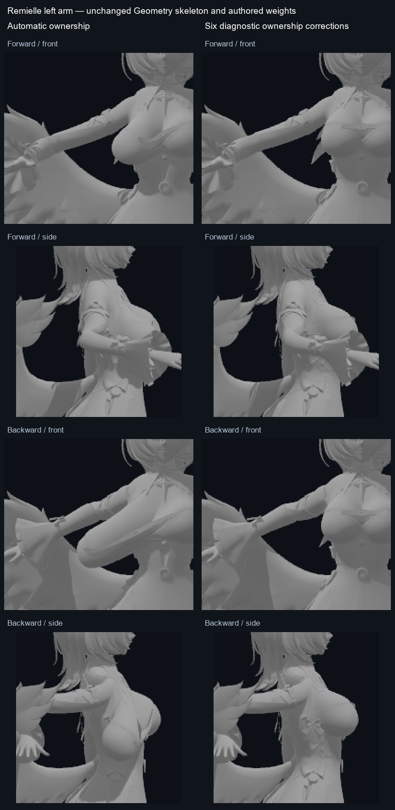

The single new image compares the same front/side shoulder crops for each pose.
The Geometry controls, camera and crop are identical across columns. The cloth
pulling improves visibly, particularly backward, while the arm still follows
the original IK solution. The retained image is cropped evidence; no additional
full-model captures are added.

The remaining compressed shoulder edge mixes upper-arm and stationary neck
weights. The remaining stretch lies at the upper-arm/forearm transition, mainly
involving influence 83. These results leave room for pivot, simplified-driver
and authored-skinning limitations; they do not justify changing those owners
from a percentile alone. Existing authored weights and the Geometry skeleton
can improve meaningfully through ownership corrections in this controlled case,
but complete anatomical quality is still unproven.

The [measurements](iteration-5/measurements.json) retain all eight scenarios,
actual rest/solved controls, support statistics, fixed edge identities and exact
restoration checks. The existing neutral one-arm lifecycle also checks the
diagnostic matrix rebasing, contribution reconstruction and cleanup; no new
test cases or CI browser jobs are added.

```text
python tools/evaluate_geometry_arm.py <remielle-mod-folder> --diagnose-shoulder --ownership-overrides docs/experiments/geometry-rig/iteration-5/ownership-overrides.json --output <capture-folder>
```

This explicit operation requires a compatible browser/WebGPU environment and
the same displayed mod variant. Omitting the override file runs only the
ownership/skeleton and pivot controls. It never saves metadata or edits source
buffers. Production Weight, binding rules, reconciliation, deformation and IK
remain unchanged. Keep PR #180 open and unmerged, and report this result before
expanding beyond this arm or model.

### Iteration 6 — test generic ownership on both arms

The evidence supports a small **within-limb segment ownership refinement** as
an experimental candidate. The same fixed rule independently corrects two
forearm-owned influences on each arm and improves forward deformation on both.
It does not establish that vertex support is better than pivot-to-segment
distance, and does not solve the shoulder/cloth boundary. All assignments stay
in the evaluator; production binding, Weight, geometry fitting and IK are
unchanged. Keep PR #180 open and unmerged.

#### Why the shoulder edge collapses

The original backward-compressed edge is still source-body vertices
13332 / 13352, sample index 8895, at 0.234×. Its moving influences 71, 70 and 127
all receive the **same rigid upper-arm transform**; influences 66 and 63 remain
on the stationary neck. With rest edge `e`, midpoint `m`, transform `T`, rotation
`R` and total moving endpoint weights `wA`, `wB`, the posed edge decomposes as
`e + mean(wA,wB)*(R*e-e) + (wB-wA)*(T*m-m)`. The saved trace also accounts for
the existing helper's over-unit weight behavior; that term is zero here.

| Component | Recorded result |
| --- | ---: |
| Rigid arm rotation alone | 1.000× edge length |
| Uniform average arm weight alone | 0.914× |
| Endpoint arm weights | 0.768870 / 0.918188 |
| Opposing weight-gradient vector magnitude / rest edge length | 0.748× |
| Reconstructed / displayed length | 0.234083 / 0.234086× |

The differential-weight term cancels much of the rotated edge. This is a blend
boundary interacting with simplified driver motion, rather than a stretching
arm matrix. Individual inferred ModelJoint pivots cancel after correct rest
rebasing when their owner is the same rigid driver. The driver's pivot still
affects `T*m-m`: Iteration 5's position-only translation moves this particular
edge to 1.684×, but creates a different 0.241× compressed edge and worsens the
backward maximum to 7.617×. It therefore does not supply a general pivot fix.
The [two signed compression traces](iteration-6/compression-trace.json) retain
source aliases, joint pivots, drivers, weights and vectors.

#### Compare support with pivot proximity

Using already decoded authored influences, the evaluator gives each displayed
rest triangle's vertices one third of its area. For each existing arm-owned
ModelJoint, it accumulates `area * authoredWeight * squaredDistanceToSegment`
over those vertices and source aliases, divides by its total support mass, and
normalizes by height squared. This is area-lumped vertex quadrature, not an
exact surface integral. Displayed duplicate draws, tessellation and the fitted
skeleton can bias it; it supplies proximity evidence, not anatomical labels.
No additional Weight system or source hierarchy is built.

Three candidates use existing driver segments: nearest inferred pivot across
all 15 drivers, lowest support score across those same drivers, and lowest
support score between the **already assigned limb's upper and lower arm**.
They change respectively 24, 20 and 4 of the 92 supported arm-owned joints.
All other owners stay fixed, including source aliases. Ties use driver IDs;
there are no new distance cutoffs, margin thresholds or component exclusions.
The broad pivot comparison separates segment representation from support data.

All IDs below are measurement evidence from
`remielle2bodyblend.buf|offset=0`; none selects implementation behavior:

| Source influences → ModelJoints | Original driver | Pivot segment / support segment |
| --- | --- | --- |
| Left 170–171 → 80–81 | Left forearm | Both select left upper arm |
| Right 172–173 → 82–83 | Right forearm | Both select right upper arm |
| Left 70 → 184 | Left upper arm | Both keep upper arm |
| Left 71 → 185 | Left upper arm | Connector / upper arm |
| Left 127 → 32 | Left upper arm | Both select chest–shoulder connector |
| Left 72–75 → 186–189 | Left upper arm | Both select chest–shoulder connector |

Influence 71's pivot scores tie at the common shoulder endpoint, while its
support favors upper arm. Influence 127's support scores are nearly tied:
0.00155974 for the connector versus 0.00156150 for upper arm. Moving 127 to the
stationary connector increases the problematic edge's weight-gradient term
from 0.748× to 0.818× and worsens its compression to 0.201×. Thus an unconstrained
argmin can reduce stretch while damaging a shared blend boundary.

#### Opposite arm and intermediate flexion

Both arms use unchanged controls, authored weights, independent IK and frozen
samples: 16,785 left edges (the prior digest) and 16,996 right edges. Four original
extreme identities per pose remain tracked for every candidate. Half targets
move the hand 6% of height up and forward/backward; full targets move it 12%.
The resulting flexion angles are 58.4–60.1° at half displacement and 61.5–64.9°
at full displacement, compared with 4.1–5.4° at rest. These are intermediate
solved angles, not half-angle interpolation; both targets are reached and arm
segment lengths are preserved.

| Arm / pose | Original max / min | Within-arm support max / min | Edges above 2×, original → candidate |
| --- | ---: | ---: | ---: |
| Left forward half | 4.303 / 0.417× | 2.899 / 0.543× | 15 → 8 |
| Left forward full | 4.558 / 0.382× | 3.056 / 0.540× | 20 → 16 |
| Left backward half | 4.233 / 0.306× | 3.905 / 0.306× | 58 → 51 |
| Left backward full | 5.725 / 0.234× | 5.725 / 0.234× | 122 → 118 |
| Right forward half | 4.029 / 0.482× | 2.735 / 0.561× | 15 → 8 |
| Right forward full | 4.215 / 0.448× | 2.865 / 0.583× | 19 → 13 |
| Right backward half | 3.976 / 0.332× | 3.825 / 0.332× | 54 → 47 |
| Right backward full | 5.578 / 0.202× | 5.578 / 0.202× | 113 → 106 |

The narrow rule reduces full forward maxima by 33% left and 32% right without
worsening these measured arm extrema. It leaves the worst backward cloth
stretch and shoulder compression unresolved. The prior six left-only inputs
leave right-arm-only results unchanged. Pivot-to-segment distance independently
agrees on all four narrow corrections, so this result supports **segment-aware
ownership**, not a claim that support distribution alone is more reliable.

The broad candidates offer larger backward stretch reductions but regress
compression: left full backward minima become 0.217× with pivot segments and
0.201× with support segments; the pivot candidate raises below-half edges from
12 to 47. Right pivot segments similarly raise below-half edges from 13 to 56.
Those assignments are unsuitable for blanket adoption despite lower maxima.

#### Small torso movement and retained evidence

A 6° forward torso bend rotates chest, neck, head and both arm control chains
about the pelvis, with the existing upper-body drivers active. The previous
72–75 torso assignments participate in 1,434 / 272 / 474 / 225 moved body-draw
vertices respectively, plus small sibling-draw overlaps. These are vertices
carrying each influence, not disjoint counts. Clothing therefore moves during
this pose instead of merely being frozen by an arm-only test.

On the fixed left shoulder sample, original / six diagnostic torso results are
1.309 / 0.899× and 1.043 / 0.899× max/min. Broad support gives 1.072 / 0.869× left
and 1.073 / 0.864× right: reduced stretch again does not imply better compression.
The narrow candidate leaves these torso extrema unchanged. This is a small
controlled movement, not full-body anatomical validation; changed edges outside
the arm samples still stretch as much as 2.526× with the six diagnostic inputs.

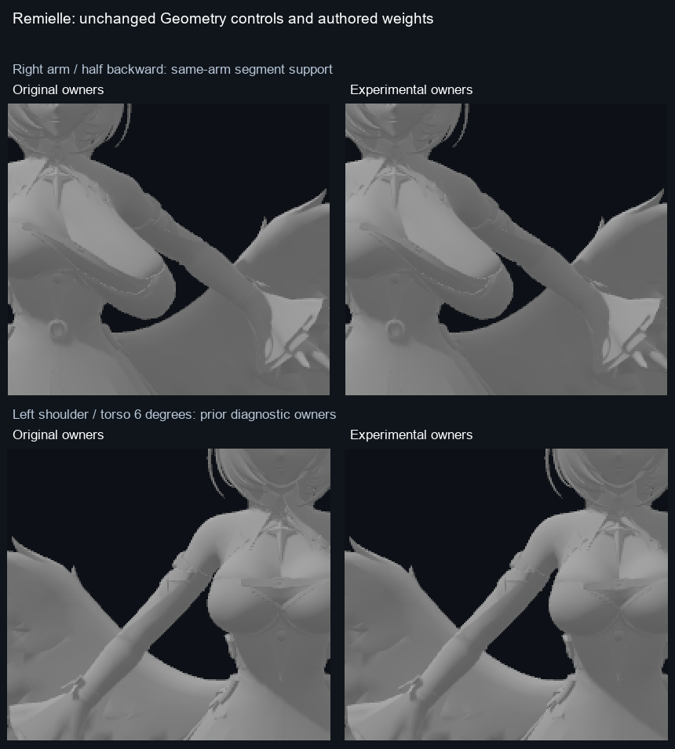

The [compact measurements](iteration-6/measurements.json) store the 92 joint
facts once, candidate inputs once, ten actual poses once, all fifty comparisons,
fixed edge identities, moving clothing references and restoration checks.
`factColumns` and `scoreColumns` describe the compact tables. Only this cropped
comparison image and the compression trace are added; raw repeated captures
and intermediate browser reports are not retained. The existing neutral arm
lifecycle now exercises both sides, support evaluation, torso motion and exact
restoration, without adding test cases or CI browser jobs.

```text
python tools/evaluate_geometry_arm.py <mod-folder> --study-binding --ownership-overrides docs/experiments/geometry-rig/iteration-5/ownership-overrides.json --output <output-folder>
```

Use the same displayed variant in a compatible browser/WebGPU environment.
Omitting the optional override file still runs all generic comparisons. No
source buffers or metadata are written, and no Weight UI analysis is requested.
The next production candidate can remain a small arm-segment assignment change;
broader shoulder/torso ownership needs blend-boundary evidence before adoption.
These results do not require another Weight-derived skeleton architecture.

### Iteration 7 — reject blanket pivot-only arm refinement

The simpler same-arm pivot rule **does not generalize across the three models**.
It reduces some Remielle forward extrema, but adds ownership changes beyond the
four supported in Iteration 6, introduces stretch and compression regressions
on Odette, and substantially worsens Chisa's arm/sleeve blend boundaries.
Keep PR #180 open and unmerged. Production binding and Weight remain unchanged;
these results do not justify promoting this candidate or the six diagnostic
Remielle assignments.

#### Fixed rule and displayed variants

For every ModelJoint already owned by an upper-arm or forearm driver, compare
its existing inferred rest pivot's squared distance to the two finite rest
segments of that same arm. Clamp the segment projection to its endpoints,
normalize by character height squared, and select the smaller score, breaking
ties by driver ID. Preserve all source aliases and rebuild driver-relative rest
matrices with the existing diagnostic helper. Other owners remain fixed. This
operation runs no vertex-support scoring pass and adds no hierarchy, threshold,
component exclusion, character mapping or game detection rule.

| Model | Displayed / inactive draws | Arm-owned ModelJoints | Changed left / right | Authored source convention |
| --- | ---: | ---: | ---: | --- |
| Remielle | 10 / 2 | 92 | 3 / 3 | Four float/u32 streams, four influences, source-local IDs |
| Odette | 35 / 10 | 55 | 3 / 3 | Two float/u32 streams, four influences, source-local IDs |
| Chisa | 19 / 24 | 136 | 10 / 11 | Seven u8 streams, eight influences, existing WWMI VertexVG model-wide remapping |

The recorded variants include displayed mesh identities, vertex counts, active
draw ranges, inactive identities and a digest. Chisa's source offsets remain
0, 27, 141, 142, 270, 391 and 419; reconciled joints with multiple source aliases
still change as one joint. Decoding and reconciliation use the existing paths.

Iteration 6's broad pivot comparison agreed on four narrow support corrections;
it did not evaluate this exact same-arm pivot argmin. The simpler rule recovers
Remielle influences 170–173 but also changes left 83 → joint 198 and right
114 → joint 18 from forearm to upper arm. Their pivots project at 0.859 and 0.883
along the upper arm, where shoulder is 0 and elbow is 1, yet the first five moved
displayed samples project beyond the elbow at 1.213–1.342. Each carries 663 moved
displayed vertices. These deterministic trace samples are inspection evidence,
not complete support proportions. No filter is added to force the result back
to four changes.

#### Both arms, stretching and compression

Original and candidate use the same fitted skeleton, authored arrays, target,
independent IK solution and frozen arm/shoulder edge set. Full displacement is
12% of height upward and 12% forward or backward; quarter, half and three-quarter
displacements supply intermediate solved poses, rather than interpolated joint
angles. All 96 compared cases reach their targets, preserve arm segment lengths,
keep unaffected controls fixed and return exactly to rest. The edge samples are
16,785 / 16,996 left/right for Remielle, 31,260 / 32,659 for Odette, and
35,881 / 36,469 for Chisa. Sample digests and baseline extreme edge identities
remain fixed across candidates.

The full-displacement table reports the **common arm sample**, including
unchanged edges. Smaller maxima indicate less stretching; larger minima
indicate less compression. Severity counts are edges above twice or below half
their rest length; percentages dominated by unchanged edges cannot conceal
these regressions.

| Model / arm / direction | Original max / min | Pivot-only max / min | Above 2×, original → candidate | Below 0.5×, original → candidate |
| --- | ---: | ---: | ---: | ---: |
| Remielle left forward | 4.558 / 0.382× | 2.681 / 0.614× | 20 → 24 | 2 → 0 |
| Remielle right forward | 4.215 / 0.448× | 2.613 / 0.583× | 19 → 26 | 1 → 0 |
| Remielle left backward | 5.725 / 0.234× | 5.725 / 0.234× | 122 → 126 | 12 → 10 |
| Remielle right backward | 5.578 / 0.202× | 5.578 / 0.202× | 113 → 118 | 13 → 12 |
| Odette left forward | 3.210 / 0.431× | 2.442 / 0.376× | 30 → 23 | 3 → 5 |
| Odette right forward | 2.923 / 0.433× | 5.071 / 0.433× | 18 → 72 | 3 → 3 |
| Odette left backward | 4.140 / 0.072× | 4.140 / 0.072× | 226 → 217 | 120 → 121 |
| Odette right backward | 4.115 / 0.068× | 4.929 / 0.068× | 212 → 267 | 112 → 112 |
| Chisa left forward | 5.530 / 0.207× | 5.530 / 0.151× | 8 → 14 | 40 → 72 |
| Chisa right forward | 4.933 / 0.174× | 10.562 / 0.116× | 12 → 33 | 36 → 71 |
| Chisa left backward | 10.833 / 0.056× | 13.303 / 0.116× | 773 → 1,151 | 315 → 291 |
| Chisa right backward | 10.374 / 0.054× | 28.267 / 0.097× | 775 → 1,196 | 267 → 257 |

Intermediate poses also fail. Odette left forward at three-quarter displacement
reduces maximum stretch from 3.129× to 2.187× but creates a newly compressed
0.404× edge, versus 0.647× originally. Chisa left forward half changes max/min
from 2.483 / 0.234× to 5.906 / 0.128×; right backward half changes them from
6.981 / 0.119× to 21.249 / 0.054×. Improved compression on Chisa's full backward
sample therefore cannot establish an overall improvement.

Every displayed draw also records changed-edge extrema and severity counts,
including changes outside the fixed arm envelope. These reuse the evaluator's
existing minimum rest length of 0.00001 height and movement tolerance of
0.000001 height; per-draw counts retain triangle-edge occurrences.
Remielle's left/right full
backward maxima there remain 10.131 / 9.970×, above the common sample's maxima.
Its left full forward changed-draw maximum is 4.222× after reassignment, rather
than the sampled 2.681×. The common sample and whole changed-draw statistics
answer different questions; neither proves full-body anatomical quality.

#### New blend-boundary failures

Odette's new right-forward maximum is body-source vertices 14552 / 14668.
Influence 49 → joint 115 changes to upper arm, while neighboring 50 → 117 and
64 → 132 stay on forearm. Influence 49's pivot favors upper arm with normalized
squared scores 0.0005884 versus 0.0012986, so this is not merely a near tie.
The changed owner splits an authored blend across two moving drivers and raises
the worst ratio to 5.071×. On the opposite arm, body vertices 16288 / 16289 mix
the newly upper-arm-owned 26 → joint 90 with forearm-owned 63 → 131, producing
the 0.404× intermediate compression. Proximity alone does not validate either
change anatomically.

Chisa's new right-backward maximum is Component1-2 vertices 22780 / 22782.
Source-offset-27 influence 89 → joint 88 becomes upper arm while neighboring
91 → joint 90 remains forearm. Its pivot projects at 0.932 along the upper arm,
but the first five moved samples project at 1.341–1.350, beyond the elbow.
The entire changed draw's maximum increases from 1.875× to 28.267×, rather than
only renaming the original shoulder extreme in another draw. This edge is very
short: 0.0167% of height at rest and 0.4733% after deformation. Its 28.267× ratio
is a local discontinuity measurement, not displacement by 28 character heights.

On Chisa's left forward half pose, Component3-1 vertices 40586 / 40589 combine
newly upper-arm-owned 242 → joint 238 with forearm-owned 253, 254, 255 and 243,
causing the new 0.128× compression. Joint 238 retains all three source aliases
at offsets 142, 270 and 391; moved samples span both proximal Component3-1 and
distal Component3-6 geometry. These arm/sleeve boundaries demonstrate why a
single inferred pivot can misrepresent an influence's displayed support.
The front crops show the affected shoulder, sleeve and torso neighborhood;
they do not supply independent anatomical labels or full-body pose validation.

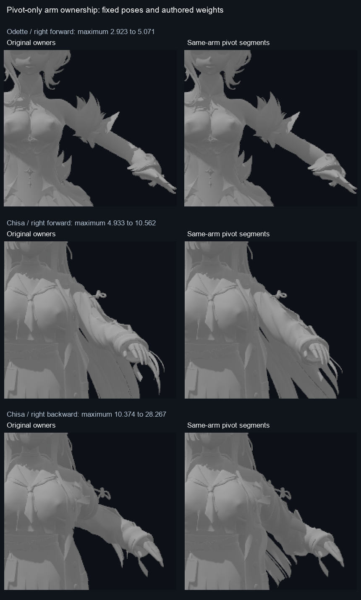

The compact [Remielle](iteration-7/remielle.json),
[Odette](iteration-7/odette.json) and [Chisa](iteration-7/chisa.json) records
retain joint facts and source aliases once, sixteen actual poses per model,
all comparisons, per-draw changes, tracked edges and exact restoration checks.
Column schemas describe their compact tuples. The eight
[signed regression traces](iteration-7/regression-traces.json) reconstruct
stretching and compression from endpoint weights and moving drivers. Each
candidate's trace records its own extreme; endpoint pairs may differ, while
baseline edge identities are tracked separately in the model records.
Only these compact results and one representative montage are retained.

```text
python tools/evaluate_geometry_arm.py <mod-folder> --compare-arm-segments --output <output-folder>
```

Use the recorded displayed variant in a compatible browser/WebGPU environment.
The operation reuses the current evaluator and measurements without expanding
the test suite. Existing focused checks and two explicit plan-verification
passes cover the experiment; browser/WebGPU work remains outside normal CI.
No source buffers or metadata are saved, no Weight UI analysis is requested,
and positions, normals, fitted rest controls and authored influences restore
exactly. The cross-model acceptance condition fails: reject blanket adoption
of this simple rule and keep the remaining shoulder blend-boundary problem
separate. No further binding architecture is introduced.

### Iteration 8 — authored relationships do not establish a reliable owner rule

The existing support method avoids Odette 49's pivot-only reassignment but
**does not avoid Chisa 89's failure**, and it introduces different regressions
on Odette. Shared authored vertices identify blends, but do not establish that
their influences should have identical simplified drivers: Remielle's successful
170–173 changes also create a boundary with strongly overlapping forearm
influences. No small reliable automatic ownership refinement is demonstrated.
Stop automatic binding experimentation for this PR, preserve the validated
geometry-fitting and skeleton-only IK work, and keep PR #180 open and unmerged.
Production binding, Weight and deformation remain unchanged.

#### Existing support versus inferred pivots

This investigation reuses Iteration 6's exact area-lumped authored-weight
mean-squared distance to the same arm's finite upper-arm/forearm segments.
It adds measurements of shared positive weights to that existing displayed
triangle pass, without changing its choices. The original source aliases and
WWMI remapping remain authoritative. No new score for choosing owners, threshold,
fallback, hierarchy, component exclusion or game rule is introduced.

Distances below are normalized by height squared. Proximal means projection
onto the fitted upper-arm line is at or before the elbow, rather than an
anatomical ground-truth label. Vertex-weight statistics sum authored weights
equally across displayed vertices; area-weight statistics use the existing
triangle-area/3 quadrature. They answer different questions.

| Influence | Pivot score upper / forearm | Support score upper / forearm | Support choice | Proximal vertex weight / area weight |
| --- | ---: | ---: | --- | ---: |
| Odette 49 → joint 115 | 0.0005884 / 0.0012986 | 0.0017062 / 0.0005030 | Keep forearm | 44.55% / 29.48% |
| Chisa 89 → joint 88 | 0.0040832 / 0.0041726 | 0.0054276 / 0.0055742 | Change to upper arm | 23.28% / 38.31% |
| Remielle 170 → joint 80 | 0.0000165 / 0.0017433 | 0.0001610 / 0.0013146 | Change to upper arm | 98.54% / 96.40% |
| Remielle 171 → joint 81 | 0.0003508 / 0.0019808 | 0.0005632 / 0.0016366 | Change to upper arm | 99.56% / 98.52% |
| Remielle 172 → joint 82 | 0.0000162 / 0.0014310 | 0.0001613 / 0.0010884 | Change to upper arm | 98.54% / 96.40% |
| Remielle 173 → joint 83 | 0.0003829 / 0.0016994 | 0.0005945 / 0.0014349 | Change to upper arm | 99.56% / 98.52% |

Odette 49's complete displayed support contains 209 vertices and favors forearm;
the method leaves its neighbors 50 and 64 on forearm too. It avoids creating
that particular split. Chisa 89's complete support contains 396 vertices in
Component1-2. Although 61.69% of its area-weight support lies beyond the elbow,
its mean squared distance still favors upper arm. Its area-weighted projection
parameter is 1.047; its equally sampled authored-weight parameter is 1.148.
A mean-distance argmin is not equivalent to the distribution's proximal/distal
mass, and neither is an anatomical label. This failure is present in one draw;
cross-source aliasing or duplicated sibling draws do not explain it.

Support keeps Remielle 83 and 114 on forearm, unlike the pivot rule. Their
vertex-weight support is 72.04% distal, while 170–173 is predominantly proximal.
It therefore retains exactly the four prior successful corrections. This useful
distinction on Remielle is insufficient to validate the method across models.

#### Shared vertices describe blends, not ownership constraints

For a pair of reconciled joints with positive weights on the same displayed
vertex, accumulate `vertexArea * authoredWeight` separately for each joint.
Divide each accumulated mass by that joint's entire displayed area-weight
support. Repeated slots for one joint are summed before counting; source aliases
remain reconciled. Counts are draw-vertex occurrences, rather than globally
welded vertices. Pair coverages overlap and must not be summed as disjoint
percentages. The quantities are diagnostics, not another assignment score.

| Source influence pair | Shared draw vertices | Fraction of first / second joint's area-weight support |
| --- | ---: | ---: |
| Odette 49 / 50 | 92 | 7.62% / 27.29% |
| Odette 49 / 64 | 104 | 45.61% / 100.00% |
| Chisa 89 / 91 | 328 | 83.33% / 100.00% |
| Chisa 89 / 88 | 278 | 94.73% / 86.84% |
| Remielle 170 / 83 | 77 | 96.63% / 46.17% |
| Remielle 170 / 69 | 79 | 96.40% / 44.06% |
| Remielle 171 / 83 | 81 | 98.30% / 38.88% |
| Remielle 172 / 114 | 77 | 96.63% / 46.17% |
| Remielle 173 / 114 | 81 | 98.30% / 38.88% |

Chisa 89 shares substantial support with both 88 and 91. Support moves 88 and
89 to upper arm while leaving 91 on forearm, so moving one neighbor with it
still leaves the harmful boundary. The same edge, vertices 22780 / 22782,
reproduces Iteration 7's 28.267× right-backward ratio and identical signed trace.
The existing short-edge qualification still applies.

Remielle demonstrates the opposite consequence of treating overlap as a
same-owner constraint. Its successful 170 / 171 changes agree with upper-arm
neighbor 69 but split from forearm neighbor 83 on over 96% of their area-weight
support. The right arm mirrors this with 172 / 173, upper-arm 105 and forearm
114. Both proximal and distal influences blend at those vertices. Forcing all
strongly shared influences onto one driver would erase this distinction;
shared weights do not supply a binary ownership requirement or a validated
source hierarchy. The measurements establish coexistence and mixed-driver
motion, rather than proving a particular adjacency rule.

#### The unchanged support rule still regresses across models

The original and existing support candidate use the recorded Iteration 7
variants, fitted controls, frozen samples and all sixteen poses per model.
All 96 comparisons reach the same targets, preserve segment lengths and
restore positions, normals and authored arrays exactly, with no Weight UI
request. Support changes 4 / 4 / 19 joints on Remielle / Odette / Chisa.
Chisa has positive displayed-area support for 131 of 136 arm-owned joints;
the other five keep their existing owners under the unchanged method.

| Model / arm / direction | Original max / min | Support max / min | Above 2×, original → support | Below 0.5×, original → support |
| --- | ---: | ---: | ---: | ---: |
| Remielle left forward | 4.558 / 0.382× | 3.056 / 0.540× | 20 → 16 | 2 → 0 |
| Remielle right forward | 4.215 / 0.448× | 2.865 / 0.583× | 19 → 13 | 1 → 0 |
| Remielle left backward | 5.725 / 0.234× | 5.725 / 0.234× | 122 → 118 | 12 → 10 |
| Remielle right backward | 5.578 / 0.202× | 5.578 / 0.202× | 113 → 106 | 13 → 12 |
| Odette left forward | 3.210 / 0.431× | 3.500 / 0.346× | 30 → 45 | 3 → 4 |
| Odette right forward | 2.923 / 0.433× | 3.204 / 0.433× | 18 → 35 | 3 → 4 |
| Odette left backward | 4.140 / 0.072× | 4.140 / 0.072× | 226 → 246 | 120 → 121 |
| Odette right backward | 4.115 / 0.068× | 4.115 / 0.068× | 212 → 230 | 112 → 113 |
| Chisa left forward | 5.530 / 0.207× | 5.530 / 0.200× | 8 → 8 | 40 → 38 |
| Chisa right forward | 4.933 / 0.174× | 10.562 / 0.116× | 12 → 16 | 36 → 37 |
| Chisa left backward | 10.833 / 0.056× | 10.833 / 0.111× | 773 → 414 | 315 → 347 |
| Chisa right backward | 10.374 / 0.054× | 28.267 / 0.111× | 775 → 434 | 267 → 306 |

These are full-displacement common-sample extrema and severity counts. Whole
changed-draw extrema remain recorded separately with the existing tolerances.
Odette's new left-forward stretch is body vertices 13633 / 13634: support moves
30 and 59 to upper arm while 26 stays forearm. Its new 0.346× compressed edge,
13584 / 13586, similarly mixes 30 and 26. Intermediate left forward at
three-quarter displacement changes max/min from 3.129 / 0.647× to
3.444 / 0.373×. Chisa right backward half changes 6.981 / 0.119× to
21.249 / 0.044×, introducing another compression regression. Lower severe
stretch counts or improved full-backward minima cannot establish overall
quality when new extrema and compressed-edge counts regress.

The single [compact evidence record](iteration-8/authored-relationships.json)
retains focused joint scores, all candidate changes, pair coverages, source
aliases, support distributions, all support-case metrics and three new signed
counterexamples. It references Iteration 7's variant, controls, poses and samples
instead of duplicating them, and reuses the existing Chisa failure trace and
[comparison image](iteration-7/cross-model-comparison.png). No new captures or
test cases are added. Existing focused checks and two explicit verification
passes cover the investigation; normal CI still excludes browser/WebGPU work.

```text
python tools/evaluate_geometry_arm.py <mod-folder> --compare-arm-support --output <output-folder>
```

Use the recorded displayed variants in a compatible browser/WebGPU environment.
This explicit evaluator operation does not save source buffers, metadata or
poses. Automatic mapping of complex authored skinning onto the simplified rig
remains unreliable with the demonstrated evidence. That does not prove such
mapping impossible; it ends this experiment without adding more heuristics or
promoting either distance method. Geometry fitting, skeleton-only IK and the
feasibility of authored-weight deformation remain demonstrated separately.
